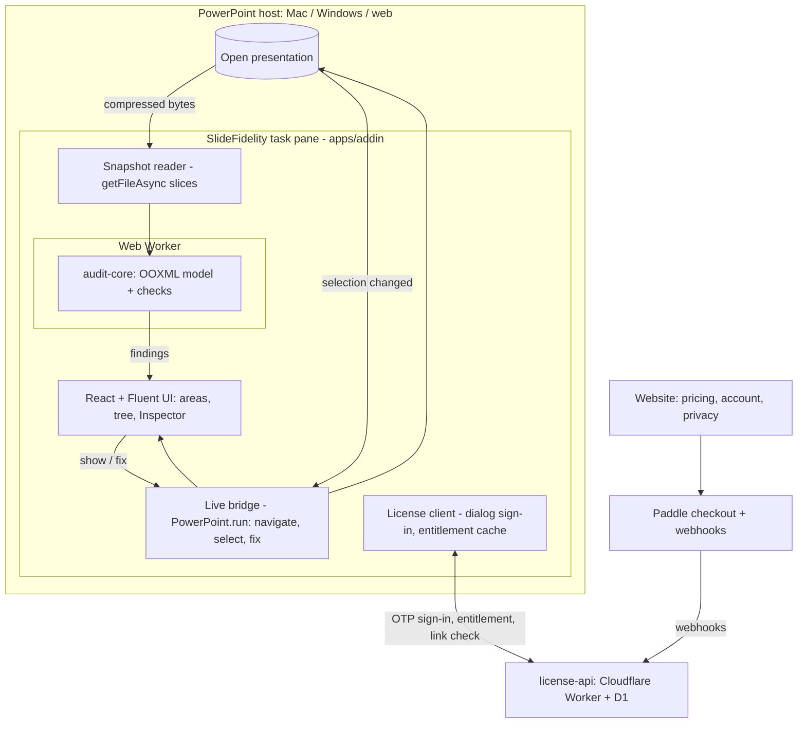
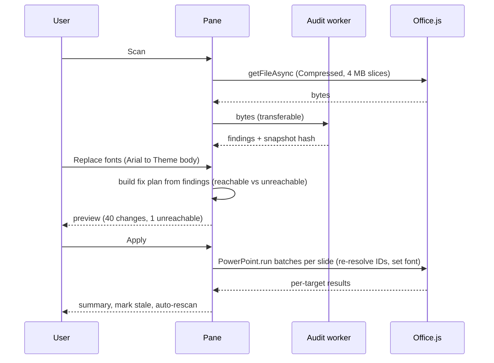
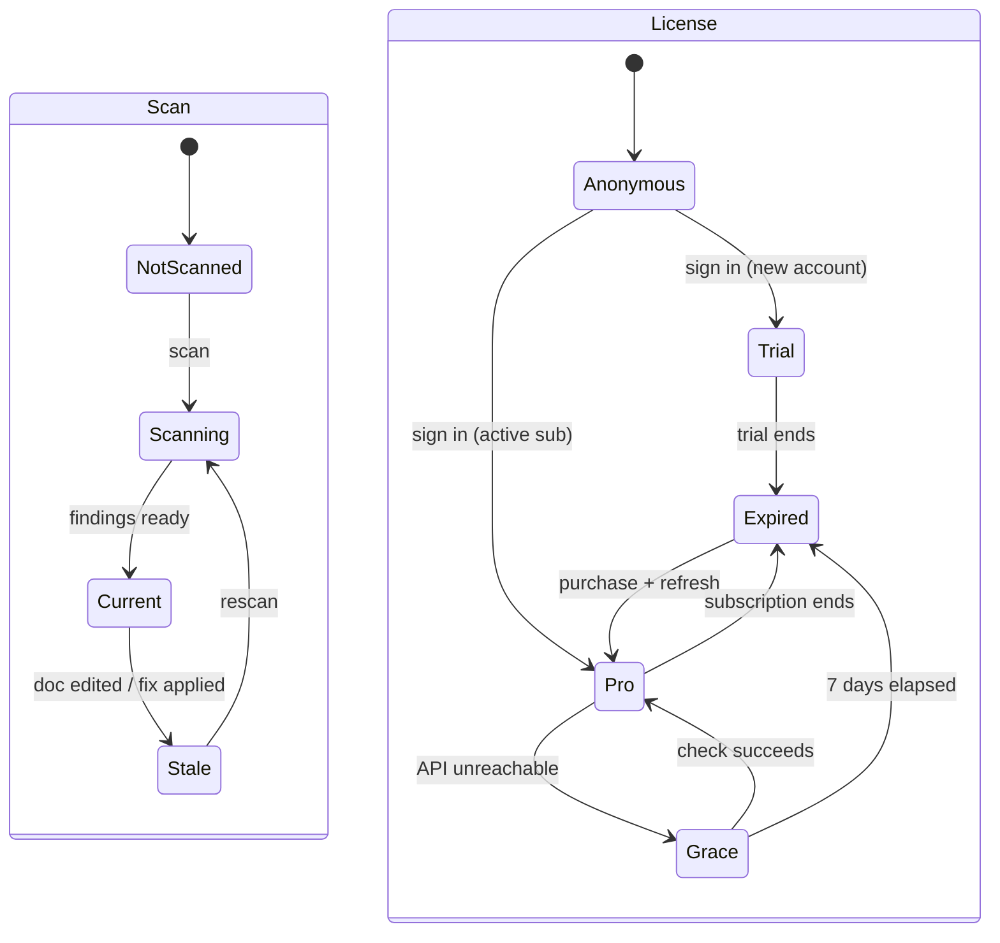

# SlideFidelity PowerPoint Add-in - Plan

**Target repo:** `SlideFidelity` (greenfield; all paths below are relative to its root).

---

## Goal Capsule

- **Objective:** A presentation designer, consultant, or trainer who opens a messy deck in PowerPoint for Mac, Windows, or the web can see every hidden quality problem in the deck in one pane. The problems cover unwanted fonts, off-brand colors, oversized images, redundant masters, broken links, and hidden content. The user can fix the common ones in a few clicks. A paid tier funds the product.
- **Means:** An Office.js task-pane add-in that audits a byte snapshot of the `.pptx` (KTD1, KTD2), applies fixes through the PowerPoint JavaScript API (KTD4), and licenses a Pro tier through its own small backend (KTD7).
- **Reference product:** Neuxpower Slidewise (Windows-only VSTO add-in). SlideFidelity matches its audit breadth and its safe-fix subset on all three desktop/web platforms.
- **Authority hierarchy:** Product Contract Requirements win on behavior. KTDs win on mechanism. Units implement; they never amend an R or KTD.
- **Stop conditions:** Stop and ask when:
  - A required fix needs a preview-only API.
  - `getFileAsync` does not reflect the live document on a platform, and no workaround is found.
  - AppSource certification rejects the licensing flow.
- **Execution profile:** Deep, phased (Foundation, Audit, UI, Fixes, Licensing, Ship). Audit engine is test-first against fixture decks.
- **Tail ownership:** The implementer owns the AppSource submission package. The user owns Partner Center, Paddle, and Cloudflare account setup.

---

## Product Contract

### Summary

Build SlideFidelity, a cross-platform PowerPoint add-in that scans the open presentation and reports quality problems in six areas: fonts, colors, media and file size, slide masters, links, and a general file review. Each finding jumps to its slide and shape. An Inspector shows details for the selected shape. One-click fixes cover font replacement, color replacement, removal of hidden, off-slide, and empty content, and hyperlink cleanup. A free tier gives read-only insight. A Pro subscription (about $79/yr) with a 30-day trial unlocks all checks and fixes.

### Problem Frame

Decks built by many contributors or assembled from copied slides accumulate problems that PowerPoint hides:

- Fonts set only for Asian or complex scripts, bullet fonts, and "hidden list styles".
- Literal colors that bypass the theme.
- Full-resolution photos scaled down to thumbnails, and cropped areas still in the file.
- Dozens of near-duplicate slide masters.
- Links to files on someone else's drive.
- Hidden slides, speaker notes, and document properties that leak confidential content.

Slidewise solves this well, but only on Windows. Mac and web users, a large share of presentation designers, have no equivalent. They fall back to unzipping the file and editing XML by hand.

### Key Decisions

- **Office.js web add-in, not VSTO/COM.** One codebase reaches Mac, Windows, and web. (session-settled: user-directed — chosen over VSTO/COM Windows-only: reach Mac and web users.) Governs R17.
- **v1 = full audit + safe in-place fixes.** Fixes that the API cannot perform in place are deferred. (session-settled: user-directed — chosen over audit-only and full Slidewise parity.) Governs R12–R16.
- **Licensing is in scope.** Free tier plus paid subscription. (session-settled: user-directed — chosen over a free, backend-less v1.) Governs R19–R21.
- **Free/Pro split mirrors Slidewise.** Free shows the Overview, the font list, and the media size breakdown. Pro unlocks every other check, the Inspector, all fixes, and link reachability. This is an agent proposal; see Assumptions. Governs R19.

### Requirements

**Scanning and navigation**

- R1. SlideFidelity scans the open presentation on demand and shows findings grouped by area. Each finding is either a warning (flag) or information (dot), and each group shows a count.
- R2. Every finding that refers to a slide or shape can take the user to that slide and select that shape in PowerPoint.
- R3. The pane shows whether the scan is current or stale. When the deck changed after the last scan, the user can rescan with one action.
- R4. An Inspector section shows the findings and key properties of the currently selected shape. Properties include fonts by script, colors, links, image dimensions/scale/crop, and autofit.

**Audit areas**

- R5. Fonts: list every font with usage count and locations. This includes fonts used by script (latin, ea, cs), bullet and symbol fonts, hidden list styles, theme major/minor fonts, and fonts inside tables, groups, charts, and SmartArt. Show the deck's font-embedding status.
- R6. Colors: list theme colors per master, and literal (non-theme) colors with usage grouped by master. List the deck's recent colors. Flag literal colors that are not in the active brand profile (R22).
- R7. Media and size: show file size broken down by media item and by slide. Flag six image problems:
  - Oversized images: native pixels far above displayed size.
  - Low-compression images: photographic PNGs, very high-quality JPEGs.
  - Cropped images whose cropped area is still stored.
  - Distorted images: unequal width/height scale.
  - Images too small for their displayed size.
  - Auto-generated fallback images (SVG PNG fallback, WDP).
- R8. Masters and layouts: show master → layout → slides usage. Flag unused layouts, unused masters, and preserved masters.
- R9. Links: list external hyperlinks and linked files (OLE, linked media and images), including those on masters and layouts.
- R10. File review: report the following content and properties:
  - Hidden slides, hidden shapes, off-slide shapes, empty placeholders, and empty sections.
  - Speaker notes, comments, and document and custom properties.
  - Animations, transitions, text autofit settings, and proofing languages.
- R11. Pro users can check link reachability. URLs are sent to the SlideFidelity backend, which reports broken links. The check runs only on explicit user action.

**Fixes**

- R12. Replace fonts: replace one or more fonts with another font everywhere the API can reach. Report occurrences it could not change, for example inside charts or SmartArt.
- R13. Replace colors: replace one or more literal colors with a theme color's value or a custom color. Offer auto-match of literal colors that equal a theme color.
- R14. Delete content: delete hidden shapes, off-slide shapes, and empty placeholders, as a selected set or all at once.
- R15. Hyperlinks: remove or edit selected hyperlinks.
- R16. Every fix shows a preview (what changes and where) before it applies. After it applies, it shows a result summary that includes items it skipped.

**Platform and privacy**

- R17. SlideFidelity runs on PowerPoint for Mac, Windows (Microsoft 365), and the web. It hides or disables features the host's API version does not support, with an explanation. It is not offered on iPad or mobile.
- R18. Deck content never leaves the user's device. The one exception is URLs the user sends for link checking (R11).

**Licensing**

- R19. Free tier: the Overview, the font list, and the media size breakdown, read-only, with no account.
- R20. A new account gets a 30-day Pro trial with no card. The server tracks the trial per account.
- R21. The user buys and manages a subscription on the SlideFidelity website. The add-in reflects a new purchase within one minute of sign-in or refresh. It keeps Pro active offline for 7 days after the last successful check.
- R22. Pro users can define a brand profile (allowed fonts and colors). The default profile is the deck's theme fonts and colors.

### Acceptance Examples

- AE1. Covers R5.
  - **Given** a text box whose visible text is Calibri, but whose `ea` font is "MS Gothic" and whose hidden list style names "Wingdings" for level 3 bullets,
  - **When** the user scans,
  - **Then** the Fonts area lists Calibri, MS Gothic (ea), and Wingdings (bullet, hidden list style) against that shape.
- AE2. Covers R12, R16.
  - **Given** "Arial" is used in 40 text boxes and in 1 chart,
  - **When** the user replaces Arial with the theme body font,
  - **Then** the preview shows 40 changes and 1 unreachable occurrence, and after apply a rescan shows Arial only in the chart.
- AE3. Covers R3.
  - **Given** a completed scan,
  - **When** the user edits a shape,
  - **Then** the status shows "stale" and fix actions ask for a rescan before applying.
- AE4. Covers R17.
  - **Given** PowerPoint for Mac 16.95 (PowerPointApi 1.8, not 1.10),
  - **When** the user opens the Links area,
  - **Then** links are listed, and "Remove link" is disabled with a "requires a newer PowerPoint" note.
- AE5. Covers R20, R21.
  - **Given** a trial account whose trial ended and no subscription,
  - **When** the user opens a Pro area,
  - **Then** the area shows a locked state with a "Manage subscription" link that opens the website in the browser.

### Success Criteria

- A 100-slide, 50 MB deck scans in under 10 seconds on a 2022-class laptop, and the pane stays responsive during the scan.
- On the fixture corpus, every seeded problem appears as a finding. No false positives appear on the "clean" fixture deck.
- A font replacement on a 100-slide deck finishes in under 30 seconds and shows progress.

### Scope Boundaries

**Deferred for later**

- "Export cleaned copy" through `PowerPoint.createPresentation`. It would cover fixes the API cannot make in place: unhide slides, delete notes or comments, remove hidden list styles, compress or crop images, remove linked files, and clear recent colors and document properties.
- Delete unused layouts and masters (`SlideLayout.delete` / `SlideMaster.delete` are preview-only today), and master consolidation.
- Replace or export images, bulk transitions, the slide-selection tool, and export slides.
- Nested App Authentication (Microsoft sign-in), team seats, and admin-managed licensing.
- Localization beyond English.

**Outside this product's identity**

- Windows-only VSTO/COM features, and iPad/mobile clients.
- Whole-file compression (NXPowerLite territory).

### Dependencies

- Accounts: Microsoft Partner Center (AppSource), Paddle (merchant of record), Cloudflare (Pages, Workers, D1), and a transactional email provider for sign-in codes.
- Test hosts: PowerPoint for Mac ≥ 16.105, Windows Microsoft 365 ≥ 2601, and PowerPoint for the web. These versions support PowerPointApi 1.10.

### Sources

- Slidewise product page: https://neuxpower.com/slidewise-powerpoint-add-in
- Slidewise help center, feature inventory: https://support.neuxpower.com/hc/en-us/categories/360001776297-Slidewise-Help
  - Articles read: Get started, Fix quality issues, Manage fonts, Organize slide masters, Fix colors, Inspector, Image audit, Slide selection, Hidden list styles, and "fonts I cannot see".

---

## Planning Contract

### Key Technical Decisions

- KTD1. **Office.js task pane in TypeScript + React + Fluent UI v9, scaffolded from the `yo office` webpack template, with the add-in-only XML manifest.**
  - The XML manifest reaches the most hosts; the unified JSON manifest excludes perpetual Windows and lacks some events.
  - The manifest declares minimum `PowerPointApi 1.3`. iPad only supports 1.1, so this keeps SlideFidelity off iPad (R17). That also avoids certification rule 1120.2, which bans purchase UI on mobile.
  - Fluent UI v9 is Microsoft's recommended UI kit for add-ins and matches the host look.
  - (session-settled: user-directed — chosen over VSTO/COM: cross-platform reach.)
- KTD2. **The audit reads an OOXML byte snapshot, not the live object model.**
  - The pane reads the document with `Office.context.document.getFileAsync(Office.FileType.Compressed)` in 4 MB slices. It parses the result with JSZip plus a streaming XML parser.
  - The live API cannot see several things the audit needs:
    - Theme-vs-literal colors.
    - Per-script, bullet, and list-style fonts.
    - Charts and SmartArt.
    - Media bytes.
    - Hidden slides, notes, comments, properties, and linked files.
  - The snapshot sees all of them. The live API is used only for navigation, the Inspector's live selection, and fixes.
- KTD3. **The audit engine is a pure TypeScript package with no Office dependency, run in a Web Worker.**
  - It takes `.pptx` bytes and returns a findings model.
  - It is unit-testable in Node against fixture decks.
  - It keeps the task pane responsive on large decks.
  - It could later power a CLI or web checker.
- KTD4. **Fixes run only through stable PowerPoint JS APIs, each gated by `isSetSupported`.**
  - Replace fonts: `ShapeFont.name`, 1.4; tables and groups, 1.8.
  - Replace colors: `fill`/`lineFormat`/`font.color`, 1.4; theme palette, 1.10.
  - Delete shapes: `shape.delete`, 1.4. Hidden-shape state: `Shape.visible`, 1.10.
  - Hyperlink edit/remove: 1.6 / 1.10.
  - No preview APIs ship in production. Fixes the API cannot make go to the deferred "Export cleaned copy".
- KTD5. **The pane joins snapshot findings to live objects by slide ID and shape ID, with name and position as fallback.**
  - The OOXML identities are `p:sldId/@id` and `p:cNvPr/@id`.
  - Before any fix, the fix engine re-resolves each target in the live model and skips targets it cannot resolve (R16).
  - The exact live ID format is verified in U2.
- KTD6. **Scan freshness uses a document-changed signal plus a snapshot hash.**
  - The pane marks the scan stale on `DocumentSelectionChanged` activity after an edit, and on any SlideFidelity fix.
  - Rescan compares the SHA-256 of the new snapshot with the previous one, so an unchanged deck returns cached findings instantly.
  - Fix actions refuse to run on a stale scan (AE3).
- KTD7. **Licensing uses a Cloudflare Worker + D1 license API, email one-time-code sign-in inside the Office dialog, and Paddle as merchant of record.**
  - Microsoft only supports free-to-download Office add-ins, so SlideFidelity is free on AppSource and sells the subscription itself.
  - Email one-time codes work for both consumer and work accounts, where NAA support for personal accounts is unverified. NAA is deferred.
  - Paddle handles global VAT and sales tax for a solo seller.
  - The Worker issues Ed25519-signed entitlement tokens. The add-in verifies them with an embedded public key and caches them for 7 days of offline grace (R21).
  - Client-side gating is convenience only. Link checking (R11) is enforced on the server.
- KTD8. **The add-in is hosted as static files on Cloudflare Pages.** The license API runs on Workers under the same domain (for example `app.slidefidelity.com` and `api.slidefidelity.com`). CORS allows only the add-in origin. Marketing, privacy, terms, and support pages live in the same Pages project.
- KTD9. **The link-check proxy is hardened against SSRF.**
  - It accepts only `http`/`https` URLs.
  - It resolves DNS and rejects private, loopback, link-local, and metadata ranges.
  - It sends `HEAD` then falls back to `GET` with a byte cap, times out after 5 s, and caps each request at 50 URLs.
  - It rate-limits per account.
- KTD10. **Fixtures:** a committed corpus of small `.pptx` decks, each seeding known problems. It is paired with a test helper that mutates a base deck's XML through JSZip to create targeted edge cases. Hand-authored decks come from PowerPoint for real-world fidelity. Generated variants cover combinatorics.

### High-Level Technical Design

Component topology:



Scan and fix sequence:



Scan freshness and license states:



### Output Structure

```text
SlideFidelity/
  package.json                 # pnpm workspace root
  pnpm-workspace.yaml
  packages/
    audit-core/                # KTD3: pure TS, no Office dependency
      src/package/             # zip + XML loading, OOXML model
      src/checks/              # fonts, colors, media, masters, links, review
      src/findings.ts
      test/fixtures/           # KTD10 corpus
  apps/
    addin/                     # KTD1: Office.js task pane
      manifest.xml
      src/taskpane/            # React UI
      src/office/              # snapshot reader, live bridge, fixes
      src/license/
      src/worker/
    license-api/               # KTD7: Cloudflare Worker + D1
      src/
      migrations/
    site/                      # KTD8: landing, pricing, privacy, terms, support
```

### Assumptions

- `getFileAsync` returns the in-memory state, including unsaved edits, on Mac and Windows. On the web it may return the last autosaved state. U2 verifies this. If the web lags, the pane forces a save wait or shows a note.
- The Free/Pro split (Key Decision 4) is an agent proposal. It is easy to change later because gating is centralized in U15.
- Target users run Microsoft 365 builds. Perpetual Office 2021/2024 on Windows (PowerPointApi ≤ 1.5) gets audit plus navigation only.
- Brand profiles live in the add-in origin's `localStorage` with JSON import/export. Server sync is deferred.
- A "missing font" check (font not installed) is best-effort. Office.js does not expose substitution. The check uses the browser `document.fonts.check` where it is reliable, and otherwise reports "not embedded" only.

### Sequencing

The six phases run in order: A Foundation (U1–U3), B Audit checks (U4–U9), C UI (U10–U11), D Fixes (U12–U13), E Licensing (U14–U15), F Ship (U16). Phase E can run in parallel with phases B–D after U1. The U9 link reachability check needs U14.

---

## Implementation Units

| U-ID | Title | Key files | Depends on |
|---|---|---|---|
| U1 | Workspace and add-in scaffold | `package.json`, `apps/addin/manifest.xml` | — |
| U2 | Snapshot reader and live-ID spike | `apps/addin/src/office/snapshot.ts` | U1 |
| U3 | OOXML package model | `packages/audit-core/src/package/` | U1 |
| U4 | Findings model and check runner | `packages/audit-core/src/findings.ts`, `apps/addin/src/worker/` | U3 |
| U5 | Font checks | `packages/audit-core/src/checks/fonts.ts` | U4 |
| U6 | Color checks and brand profile | `packages/audit-core/src/checks/colors.ts` | U4 |
| U7 | Media and size checks | `packages/audit-core/src/checks/media.ts` | U4 |
| U8 | Masters and file-review checks | `packages/audit-core/src/checks/masters.ts`, `review.ts` | U4 |
| U9 | Link checks | `packages/audit-core/src/checks/links.ts` | U4 (U14 for reachability) |
| U10 | Task pane UI and navigation | `apps/addin/src/taskpane/` | U2, U4 |
| U11 | Inspector | `apps/addin/src/taskpane/Inspector.tsx` | U10 |
| U12 | Fix engine | `apps/addin/src/office/fixes/engine.ts` | U10 |
| U13 | Fix actions | `apps/addin/src/office/fixes/*.ts` | U12, U5, U6, U8, U9 |
| U14 | License API | `apps/license-api/` | U1 |
| U15 | Add-in licensing client and gating | `apps/addin/src/license/` | U14, U10 |
| U16 | Store readiness and CI | `apps/site/`, `.github/workflows/ci.yml` | all |

### U1. Workspace and add-in scaffold

**Goal:** A pnpm workspace with the `audit-core` package and the `addin` app. The add-in sideloads on PowerPoint for Mac, Windows, and web and shows an empty task pane.

**Requirements:** R17; KTD1, KTD8.

**Dependencies:** none.

**Files:**
- `package.json`, `pnpm-workspace.yaml`, `tsconfig.base.json`, `.eslintrc.cjs`, `vitest.workspace.ts`
- `apps/addin/manifest.xml`, `apps/addin/webpack.config.js`, `apps/addin/src/taskpane/index.tsx`
- `packages/audit-core/package.json`

**Approach:**
1. Generate the add-in with `yo office` (TypeScript, React task pane, XML manifest), then move it into `apps/addin`.
2. Set the manifest's host to Presentation, with `<Requirements>` minimum `PowerPointApi 1.3`, a ribbon button on the Home tab, and HTTPS dev certs.
3. Use `@types/office-js` (stable) only.

**Execution note:** Mostly scaffolding. Prove it with a sideload smoke test on all three hosts, not unit tests.

**Test scenarios:** Test expectation: none -- scaffolding. Manifest validation (`office-addin-manifest validate`) runs in U16 CI.

**Verification:** The ribbon button opens the pane on Mac, Windows, and web. The manifest validates.

### U2. Snapshot reader and live-ID spike

**Goal:** Read the open deck as bytes reliably, and settle how OOXML IDs map to live Office.js IDs.

**Requirements:** R1, R3; KTD2, KTD5, KTD6.

**Dependencies:** U1.

**Files:**
- `apps/addin/src/office/snapshot.ts`, `apps/addin/src/office/snapshot.test.ts`
- `apps/addin/src/office/ids.ts`, `apps/addin/src/office/ids.test.ts`
- `docs/notes/office-js-platform-behavior.md`

**Approach:**
1. Read slices with `getSliceAsync` sequentially, concatenate them into one `Uint8Array`, and always `closeAsync`, including on error.
2. Compute a SHA-256 hash with `crypto.subtle`.
3. Spike on each host and record the answers in the notes file:
   - Does the snapshot include unsaved edits?
   - What is the live `Slide.id` / `Shape.id` format compared with `p:sldId/@id` and `p:cNvPr/@id`?
4. Encode the answers in `ids.ts` as a pure mapping function with a name-plus-position fallback.

**Test scenarios:**
- Happy: a mocked `Office.File` with 3 slices returns their concatenation in order and calls `closeAsync` once.
- Error: slice 2 fails; the reader rejects with a typed `SnapshotError` and still calls `closeAsync`.
- Edge: a zero-slice file rejects with "empty document".
- Happy: `ids.ts` maps a live slide ID in the observed format to the OOXML slide ID and back.
- Edge: when a shape ID is absent in the live model, the name-plus-position fallback matches a shape with the same name on the same slide.

**Verification:** The platform-behavior note is complete for all three hosts. Snapshot tests pass.

### U3. OOXML package model

**Goal:** Turn `.pptx` bytes into a typed, lazily parsed model of the presentation parts that the checks need.

**Requirements:** R5–R10 (enabler); KTD3.

**Dependencies:** U1.

**Files:**
- `packages/audit-core/src/package/{zip.ts,rels.ts,model.ts,xml.ts}`
- `packages/audit-core/test/package.test.ts`
- `packages/audit-core/test/fixtures/*.pptx`
- `packages/audit-core/test/helpers/mutateDeck.ts`

**Approach:**
1. Load the zip with JSZip. Resolve `_rels` relationships into a part graph: presentation → slides, layouts, masters, theme; slide → layout, media, charts, diagrams, notes, comments, external targets.
2. Parse XML with a fast namespace-aware parser (for example `fast-xml-parser` with attribute preservation).
3. Model the following:
   - Slide order and hidden flag.
   - Sections.
   - Master → layout → slide usage.
   - Theme colors and fonts.
   - Media parts with byte sizes.
   - Document properties (core, app, custom).
   - Font embedding list.
   - Recent colors (`presProps.xml` `p:clrMru`).
4. Walk shapes recursively (groups, graphic frames) and yield a stable shape reference: slide or layout or master, shape ID, name, and path.
5. Build the fixture corpus (KTD10). Handcraft these decks in PowerPoint:
   - `clean.pptx`
   - `fonts-hidden.pptx`
   - `colors-literal.pptx`
   - `media-bloat.pptx`
   - `masters-messy.pptx`
   - `links.pptx`
   - `review-leaks.pptx`
   `mutateDeck` generates the edge cases.

**Execution note:** Test-first against fixtures.

**Test scenarios:**
- Happy: `clean.pptx` yields the expected slide count, one master, and the theme's 12 colors and 2 fonts.
- Happy: `masters-messy.pptx` yields per-layout usage lists that match the known slide assignments.
- Edge: a group inside a group inside a graphic frame is walked, and its shape references carry the nested path.
- Edge: a deck with a missing optional part (no `presProps.xml`) loads, with empty recent colors.
- Error: corrupt zip bytes reject with `PackageError('not a pptx')`, and a `.docx` is rejected too.
- Edge: a relationship with `TargetMode="External"` is modeled as external and never resolved as a part.

**Verification:** Package tests pass on every fixture. Parsing `media-bloat.pptx` (about 50 MB) stays under a set memory and time budget in Node.

### U4. Findings model and check runner

**Goal:** A shared findings contract and a runner that executes checks in a Web Worker and streams progress.

**Requirements:** R1, R3; KTD3, KTD6.

**Dependencies:** U3.

**Files:**
- `packages/audit-core/src/findings.ts`, `packages/audit-core/src/runner.ts`
- `packages/audit-core/test/runner.test.ts`
- `apps/addin/src/worker/audit.worker.ts`, `apps/addin/src/worker/client.ts`

**Approach:**
1. Each finding has these fields: `id`, `area`, `kind`, `severity` (warning or info), `title`, `detail`, `targets[]` (shape references), `fixes[]` (fix kinds available), and `data`.
2. Each check is a pure function from the model and options (brand profile) to findings.
3. The runner isolates each check, so one failing check yields an "error" finding and the others still run.
4. The worker receives bytes as a transferable, posts progress per area, and caches results by snapshot hash.

**Test scenarios:**
- Happy: the runner over `clean.pptx` returns findings for every area, with zero warnings.
- Error: a check that throws produces one `check-failed` finding for its area while the other areas return results.
- Happy: a second run with the same hash returns the cached result without re-parsing (the parse spy is called once).
- Integration: the worker client posts bytes and receives progress events in area order, then the final result.

**Verification:** A worker round trip completes in the add-in against a real deck on one host.

### U5. Font checks

**Goal:** Implement the Fonts area (R5), including the fonts PowerPoint hides.

**Requirements:** R5, R22; AE1.

**Dependencies:** U4.

**Files:**
- `packages/audit-core/src/checks/fonts.ts`
- `packages/audit-core/test/checks/fonts.test.ts`

**Approach:**
1. Collect `a:latin`, `a:ea`, `a:cs`, `a:sym`, and `a:buFont` from run properties, paragraph properties, `a:lstStyle` in shapes ("hidden list styles"), master and layout text styles, theme font scheme, chart XML, and diagram (SmartArt) drawing parts.
2. Resolve `+mj-*` / `+mn-*` references to theme fonts, and label them as theme usage.
3. Tag each usage with its script label (latin, ea, cs, bu, sym) and its source. The source is one of: direct, hidden-list-style, master, chart, smartart, or theme-default.
4. Mark each usage reachable or unreachable by the fix engine. Chart, SmartArt, list-style, and theme sources are unreachable.
5. Report embedding status from `p:embeddedFontLst`.
6. Flag fonts outside the brand profile as warnings.

**Test scenarios:**
- Covers AE1. The seeded text box reports Calibri (latin, direct), MS Gothic (ea, direct), and Wingdings (bu, hidden-list-style).
- Happy: a `+mn-lt` reference counts as the theme minor font, labeled "theme".
- Happy: a font used only in chart XML is listed with source `chart` and reachable=false.
- Edge: a shape with no text but default run properties in `a:lstStyle` still reports its fonts.
- Happy: a brand profile allowing only Calibri produces warnings for every other font. The default profile (theme fonts) produces none on `clean.pptx`.
- Happy: embedding status reads "Embedded subset" on a fixture saved with subset embedding.

**Verification:** Font tests pass. On `fonts-hidden.pptx`, every seeded font is found.

### U6. Color checks and brand profile

**Goal:** Implement the Colors area (R6) and the brand-profile model shared with fonts (R22).

**Requirements:** R6, R13 (auto-match data), R22.

**Dependencies:** U4.

**Files:**
- `packages/audit-core/src/checks/colors.ts`, `packages/audit-core/src/brand.ts`
- `packages/audit-core/test/checks/colors.test.ts`, `packages/audit-core/test/brand.test.ts`

**Approach:**
1. Classify every color reference as theme (`a:schemeClr`) or literal (`a:srgbClr`, `a:sysClr`, `a:prstClr`). Record its usage context (fill, line, text, effect), its master group, and whether the fix engine can reach it. The fix engine cannot reach charts, SmartArt, or gradients.
2. For each literal color, compute the nearest theme color with CIEDE2000. Mark it auto-matchable when the distance is 0.
3. The brand profile holds allowed fonts, allowed colors, and a tolerance. By default it is derived from the theme. It is serializable as JSON.

**Test scenarios:**
- Happy: `colors-literal.pptx` lists the seeded literal colors with correct counts per master.
- Happy: a literal `#4472C4` in a deck whose accent1 is `#4472C4` is auto-matchable to accent1.
- Edge: `schemeClr` with `lumMod`/`lumOff` modifiers counts as theme, not literal.
- Happy: recent colors from `p:clrMru` are listed as info.
- Edge: a gradient stop's literal color is listed with reachable=false.
- Happy: brand JSON round-trips. An invalid hex in the imported JSON is rejected with a field-level error.

**Verification:** Color and brand tests pass.

### U7. Media and size checks

**Goal:** Implement the Media & size area (R7).

**Requirements:** R7, R19.

**Dependencies:** U4.

**Files:**
- `packages/audit-core/src/checks/media.ts`, `packages/audit-core/src/imageHeader.ts`
- `packages/audit-core/test/checks/media.test.ts`

**Approach:**
1. Read native pixel dimensions and format from image headers (PNG, JPEG, GIF, BMP, TIFF, WDP, SVG viewBox). Do not decode the full image.
2. Compute the displayed size from `a:ext` (EMU) and `a:srcRect` crop.
3. Compute effective PPI and flag these problems:
   - Oversized: above 300 PPI at display size and more than 200 KB.
   - Too small: below 96 PPI.
   - Distorted: width and height scale differ by more than 2%.
   - Cropped retained: any `srcRect` is present.
   - Low compression: a PNG whose header or entropy suggests a photo, or a JPEG larger than the expected bytes per pixel.
   - Auto-generated: an `asvg:svgBlip` PNG fallback, or a `wdp` companion.
4. Attribute each media part's bytes to every slide that uses it, and mark a part shared by several slides as shared.
5. Build a size breakdown for the file: media, fonts, XML, and other.

**Test scenarios:**
- Happy: a 4000×3000 JPEG displayed at 2×1.5 inches is flagged oversized, with its effective PPI shown.
- Happy: an image scaled 100% × 60% is flagged distorted with both scale factors.
- Edge: an image reused on 5 slides counts its bytes once in the total, is attributed to all 5 slides, and is marked shared.
- Happy: an SVG with a PNG fallback reports the fallback as auto-generated.
- Edge: an unknown image format is listed with its size and without dimension-based flags, and the scan does not error.
- Happy: size breakdown categories sum to the zip's total uncompressed-part size.

**Verification:** Media tests pass. `media-bloat.pptx` flags match the seeded list.

### U8. Masters and file-review checks

**Goal:** Implement the Masters area (R8) and the File Review area (R10).

**Requirements:** R8, R10.

**Dependencies:** U4.

**Files:**
- `packages/audit-core/src/checks/masters.ts`, `packages/audit-core/src/checks/review.ts`
- `packages/audit-core/test/checks/masters.test.ts`, `packages/audit-core/test/checks/review.test.ts`

**Approach:**
1. Masters:
   - Build the usage tree.
   - Report unused layouts and unused masters. A master is unused when all of its layouts are unused.
   - Report masters with `preserve="1"` as preserved.
   - Warn when the deck has more than one active master with near-identical layout names.
2. Review:
   - Hidden slides (`show="0"`).
   - Hidden shapes (`cNvPr hidden="1"`).
   - Off-slide shapes: bounding box fully outside `p:sldSz`.
   - Empty placeholders: a `p:ph` with no text and no media.
   - Empty sections.
   - Notes with text.
   - Comments, both legacy and modern threaded.
   - Core, app, and custom properties that are not empty.
   - Slides with animations (`p:timing`) and transitions.
   - Autofit mode counts.
   - Proofing languages (`lang` / `altLang`).

**Test scenarios:**
- Happy: `masters-messy.pptx` reports the seeded unused layouts, one preserved unused master, and the correct usage counts.
- Happy: `review-leaks.pptx` reports the hidden slide, the hidden shape, the off-slide shape, 2 empty placeholders, the empty section, notes, a threaded comment, and a custom property "Client".
- Edge: a shape partially off-slide is not flagged. A shape fully off-slide is flagged.
- Edge: a placeholder holding only a picture is not reported as empty.
- Happy: languages en-US and de-DE are listed with shape counts.
- Edge: a deck with no sections produces no section findings and no error.

**Verification:** Masters and review tests pass.

### U9. Link checks

**Goal:** Implement the Links area (R9), and reachability checking through the backend (R11).

**Requirements:** R9, R11, R18; KTD9.

**Dependencies:** U4. Reachability needs U14.

**Files:**
- `packages/audit-core/src/checks/links.ts`, `packages/audit-core/test/checks/links.test.ts`
- `apps/addin/src/office/linkCheck.ts`, `apps/addin/src/office/linkCheck.test.ts`

**Approach:**
1. Collect external relationships on slides, layouts, and masters, and classify each as:
   - Hyperlink: `hlinkClick`/`hlinkHover`.
   - Linked file: an OLE object, or linked media or image.
   - Slide-internal jump, which is excluded.
2. Warn on local-path links (`file:`, drive letters, UNC paths). They break on any other machine.
3. Reachability is a separate, user-triggered call. It sends URLs only, in batches of at most 50, and merges the per-URL status into findings.

**Test scenarios:**
- Happy: `links.pptx` lists 3 web hyperlinks, 1 linked Excel OLE, and 1 link on a layout, each attributed to the correct location.
- Happy: a `file:///C:/Users/...` target is a warning labeled "local file path".
- Edge: an internal slide jump (`ppaction://hlinksldjump`) is not listed as external.
- Integration: the link-check client batches 120 URLs into 3 requests and merges statuses. A 429 response surfaces as "rate limited, try later" without failing the scan.
- Error: when the API is unreachable, reachability shows "not checked" and the listed links remain.

**Verification:** Link tests pass. A live check against the staging API marks a known 404 URL as broken.

### U10. Task pane UI and navigation

**Goal:** The main pane: an area picker, a findings tree with counts, warning flags and info dots, freshness status, scan progress, and "Show in PowerPoint".

**Requirements:** R1, R2, R3, R17; AE3, AE4.

**Dependencies:** U2, U4.

**Files:**
- `apps/addin/src/taskpane/{App.tsx,AreaPicker.tsx,FindingsTree.tsx,StatusBar.tsx,Overview.tsx}`
- `apps/addin/src/office/navigate.ts`, `apps/addin/src/office/capabilities.ts`
- `apps/addin/src/taskpane/__tests__/*.test.tsx`

**Approach:**
1. Show seven areas (Overview, Fonts, Colors, Media, Masters, Links, Review) in a dropdown, suited to a narrow pane.
2. Virtualize the tree so thousands of nodes render smoothly.
3. `capabilities.ts` probes `isSetSupported` once and exposes feature flags. The UI disables actions with a reason tooltip (AE4).
4. Navigation:
   - Go to the slide with `presentation.setSelectedSlides` (1.5).
   - Select the shape with `slide.setSelectedShapes` (1.5).
   - Degrade to slide-only below 1.5.
   - Targets on layouts and masters show a "located on layout X" note, because the API cannot open master view.
5. Freshness follows KTD6. Listen for `DocumentSelectionChanged` to detect activity that may have edited the deck.

**Test scenarios:**
- Happy: given findings, the tree renders each area with the correct warning and info counts.
- Happy: clicking "Show in PowerPoint" on a shape finding calls the navigation bridge with the resolved slide and shape IDs.
- Edge: a layout-level target shows the layout note and does not call `setSelectedShapes`.
- Covers AE3. After a simulated edit event, the status shows stale and fix buttons are disabled with "Rescan first".
- Covers AE4. With capabilities lacking 1.10, "Remove link" is disabled with the upgrade note.
- Edge: 5,000 findings render with only visible rows mounted.

**Verification:** A manual pass on Mac and web scans a fixture, navigates to 5 targets correctly, and shows the stale state after an edit.

### U11. Inspector

**Goal:** A bottom section showing findings and properties for the current selection.

**Requirements:** R4.

**Dependencies:** U10.

**Files:**
- `apps/addin/src/taskpane/Inspector.tsx`, `apps/addin/src/office/selection.ts`
- `apps/addin/src/taskpane/__tests__/Inspector.test.tsx`

**Approach:**
1. On selection change, read the selected shape IDs with `getSelectedShapes` (1.5).
2. Map them to snapshot shape references (KTD5) and show that shape's findings and model properties:
   - Fonts by script.
   - Colors.
   - Links.
   - Image PPI, scale, and crop.
   - Autofit.
   - Hidden list styles.
3. Debounce selection events. When the scan is stale, show "may be out of date".

**Test scenarios:**
- Happy: selecting the AE1 text box shows three fonts with script labels and a "Hidden list styles" node.
- Happy: selecting an image shows its native dimensions, effective PPI, and scale factors.
- Edge: multi-selection shows a count and the combined findings.
- Edge: a selected shape created after the scan shows "not in last scan — rescan".

**Verification:** A manual pass across fixtures on one host.

### U12. Fix engine

**Goal:** Shared machinery for all fixes: plan, preview, batched apply, results, and the post-fix rescan.

**Requirements:** R16; KTD4, KTD5, KTD6.

**Dependencies:** U10.

**Files:**
- `apps/addin/src/office/fixes/engine.ts`, `apps/addin/src/office/fixes/engine.test.ts`
- `apps/addin/src/taskpane/FixDialog.tsx`

**Approach:**
1. A fix kind declares three things:
   - `plan(findings, params)`, which returns reachable and unreachable targets.
   - `apply(context, batch)`.
   - The requirement set it needs.
2. The engine checks freshness, shows the preview (counts per slide, and the unreachable list), then applies in batches of about 25 targets per `context.sync`.
3. For each target, the engine re-resolves it in the live model and records one of: changed, skipped (not found), or failed (with error).
4. The engine reports progress and allows cancel between batches.
5. On completion, the engine marks the scan stale and triggers a rescan.
6. The preview says that PowerPoint's undo history may not capture add-in changes, and advises saving a copy first.

**Test scenarios:**
- Happy: a plan with 60 targets applies in 3 batches, and the summary reports 60 changed.
- Edge: 2 targets deleted since the scan are reported as skipped, and the other targets are still applied.
- Error: a batch whose `sync` throws marks that batch's targets failed, and the engine continues with the next batch.
- Edge: cancel after batch 1 stops further batches, and the summary reports the partial result.
- Integration: a completed fix sets the freshness state to stale and invokes the rescan once.

**Verification:** Engine tests pass with a mocked `PowerPoint.RequestContext`.

### U13. Fix actions

**Goal:** Implement the v1 fixes: replace fonts, replace colors, delete hidden, off-slide, or empty content, and remove or edit hyperlinks.

**Requirements:** R12, R13, R14, R15; AE2.

**Dependencies:** U12, U5, U6, U8, U9.

**Files:**
- `apps/addin/src/office/fixes/{replaceFonts.ts,replaceColors.ts,deleteShapes.ts,hyperlinks.ts}`
- matching `*.test.ts` files
- `apps/addin/src/taskpane/fixes/*.tsx`

**Approach:**
1. Replace fonts:
   - Set `textFrame.textRange.font.name` when the range is uniform.
   - For a mixed range, bisect with `getSubstring` to find the runs that use the target font, and set only those.
   - Tables use per-cell fonts (1.8). Groups recurse (1.8).
   - The theme body and heading fonts resolve to their names from the snapshot.
2. Replace colors:
   - Set solid fill, line color, and font color where the current resolved RGB matches.
   - "Replace with theme color" writes that theme color's current RGB. The API cannot write a theme reference, and the preview states this.
3. Delete: `shape.delete()` for hidden, off-slide, or empty-placeholder targets. The UI requires confirmation.
4. Hyperlinks:
   - Edit sets `address` (1.6).
   - Remove uses `Hyperlink.delete()` (1.10).
   - Layout and master links are listed but not fixable.

**Test scenarios:**
- Covers AE2. Replacing Arial across a fixture plan yields 40 changed and 1 unreachable (chart), and the unreachable item is named in the summary.
- Happy: a mixed-font text box ("Hello " Arial + "world" Calibri) replaced Arial→Georgia changes only "Hello ".
- Edge: a font set only in `ea` (unreachable by `font.name`) is reported unreachable, not silently skipped.
- Happy: color replacement of `#FF0000`→accent2 changes fill, line, and text instances and leaves gradients listed unreachable.
- Happy: deleting 3 selected off-slide shapes removes exactly those IDs.
- Error: hyperlink removal on a host without 1.10 is blocked at plan time with the capability reason.

**Verification:** Unit tests pass with mocks. A manual round trip on Mac, Windows, and web runs each fix on fixtures, and the rescan confirms the result.

### U14. License API

**Goal:** A Cloudflare Worker + D1 service providing email OTP sign-in, trials, Paddle webhooks, signed entitlements, and a hardened link-check proxy.

**Requirements:** R11, R19, R20, R21; KTD7, KTD8, KTD9.

**Dependencies:** U1.

**Files:**
- `apps/license-api/src/{index.ts,auth.ts,entitlement.ts,paddle.ts,linkcheck.ts,ssrf.ts}`
- `apps/license-api/migrations/0001_init.sql`
- `apps/license-api/wrangler.toml`
- `apps/license-api/test/*.test.ts`

**Approach:**
1. Tables: `accounts` (email, created_at, trial_ends_at), `otp_codes` (hashed, expiry, attempts), `subscriptions` (paddle ids, status, current_period_end), `webhook_events` (id for idempotency).
2. `POST /auth/start` emails a 6-digit code. `POST /auth/verify` returns a session JWT. Codes expire in 10 minutes, allow at most 5 attempts, and are rate-limited per IP and per email.
3. `GET /entitlement` returns an Ed25519-signed token {plan: free|trial|pro, exp: now+24h, grace_until: now+7d}.
4. `POST /paddle/webhook` verifies the Paddle signature, stores the event ID idempotently, and updates the subscription.
5. The checkout and customer-portal links are account-bound.
6. `POST /linkcheck` requires Pro and applies KTD9 limits.
7. Secrets (Ed25519 private key, Paddle webhook secret, email API key) are stored as Worker secrets. CORS allows only the add-in and site origins.

**Execution note:** Security-sensitive. Write the auth, webhook, and SSRF tests before the handlers.

**Test scenarios:**
- Happy: start then verify with the correct code returns a session. A new account gets `trial_ends_at` = now + 30 days (R20).
- Error: a wrong code 5 times locks that code. An expired code is rejected.
- Error: a webhook with a bad signature returns 400 and changes nothing. A replayed event ID is a no-op.
- Happy: a `subscription.activated` webhook, then `/entitlement`, returns plan=pro. `subscription.canceled` with a period end in the past returns expired (free).
- Happy: the entitlement signature verifies with the public key. A tampered payload fails verification.
- Error (SSRF): `/linkcheck` rejects `http://169.254.169.254/`, `http://localhost`, `http://10.0.0.5`, and a hostname resolving to a private IP.
- Error: `/linkcheck` from a free account returns 403. More than 50 URLs returns 400.
- Edge: CORS preflight from an unlisted origin gets no allow header.
- Happy: `DELETE /account` removes the account, sessions, and OTP rows, and cancels the Paddle subscription through the Paddle API. This supports the privacy page's deletion promise.

**Verification:** Worker tests pass under `wrangler`/Miniflare. The staging deploy completes a full sandbox purchase flow in Paddle.

### U15. Add-in licensing client and gating

**Goal:** Sign-in, entitlement caching and verification, and centralized Pro gating in the add-in, without purchase UI inside the pane.

**Requirements:** R19, R20, R21; AE5; KTD7.

**Dependencies:** U14, U10.

**Files:**
- `apps/addin/src/license/{client.ts,entitlement.ts,gate.ts}`
- `apps/addin/src/taskpane/Account.tsx`
- `apps/addin/src/dialog/signin.html`, `apps/addin/src/dialog/signin.tsx`
- `apps/addin/src/license/*.test.ts`

**Approach:**
1. Sign-in runs in `Office.context.ui.displayDialogAsync` (email → code), and returns the session with `messageParent`.
   - The dialog page is served from the add-in's own origin, so `messageParent` works without extra configuration. The dialog calls the API cross-origin under the KTD8 CORS allowlist.
   - The web client blocks dialogs that are not opened by a user gesture, so sign-in opens only from a button click.
2. Store the session and entitlement in `localStorage`, with try/catch and a memory fallback.
3. Verify the entitlement signature locally, and refresh when it expires or on user demand.
4. `gate.ts` is the single source of truth for which areas, checks, and fixes are Pro. The UI shows a locked state with "Manage subscription", which opens the website with `Office.context.ui.openBrowserWindow`. No prices or checkout appear inside the add-in.
5. Offline: keep Pro until `grace_until`.

**Test scenarios:**
- Happy: an anonymous user sees the Overview, Fonts list, and Media sizes, and the other areas are locked (R19).
- Covers AE5. An expired entitlement shows the locked state with a working "Manage subscription" link.
- Happy: after purchase on the website, pressing Refresh fetches plan=pro and unlocks the areas without a reload.
- Edge: with the network down, a cached Pro token within grace stays Pro. After grace expires it falls back to free, and the UI explains why.
- Error: a tampered cached token is discarded and treated as anonymous.
- Edge: when `localStorage` throws, the session persists in memory for the session only.

**Verification:** Tests pass. A manual sign-in, trial, and sandbox purchase works on Mac, Windows, and web.

### U16. Store readiness and CI

**Goal:** CI quality gates, the public website pages, and an AppSource-ready package.

**Requirements:** R17, R18; KTD1, KTD8.

**Dependencies:** all prior units.

**Files:**
- `.github/workflows/ci.yml`
- `apps/site/src/{index,pricing,privacy,terms,support}.html`
- `apps/addin/assets/icon-*.png`
- `docs/release/appsource-checklist.md`

**Approach:**
1. CI runs typecheck, lint, unit tests, `office-addin-manifest validate`, and the Worker tests.
2. The privacy page states that deck content stays on the device, and that only link URLs and the account email are sent (R18).
3. The listing description discloses the Pro features. The terms and privacy pages contain no commerce UI, per the certification guidance.
4. The production manifest points at `app.slidefidelity.com`.

**Test scenarios:** Test expectation: none -- CI and static content. Proven by a green CI run and a manifest validation pass.

**Verification:** CI is green on main. The AppSource checklist is complete, and a validation submission raises no blocking issues.

---

## Verification Contract

| Gate | Command / method | Applies to |
|---|---|---|
| Typecheck | `pnpm -r typecheck` | all |
| Lint | `pnpm -r lint` | all |
| Unit tests | `pnpm -r test` (Vitest) | U2–U15 |
| Worker tests | `pnpm --filter license-api test` (Miniflare) | U14 |
| Manifest | `pnpm --filter addin validate` (`office-addin-manifest validate manifest.xml`) | U1, U16 |
| Fixture corpus | every seeded problem found; `clean.pptx` has zero warnings | U3–U9 |
| Performance | 100-slide / 50 MB fixture scans in < 10 s in the add-in | U4–U10 |
| Host smoke matrix | sideload + scan + navigate + each fix on Mac ≥ 16.105, Windows M365 ≥ 2601, PowerPoint web | U10–U15 |
| Payments | Paddle sandbox purchase → Pro within 1 minute | U14, U15 |

---

## Definition of Done

- Every R1–R22 is met, or explicitly degraded per R17 with a visible reason.
- AE1–AE5 pass as automated or recorded manual tests.
- All Verification Contract gates are green.
- `docs/notes/office-js-platform-behavior.md` records the U2 spike answers.
- No preview-only Office.js API is referenced in production code.
- Deck bytes never leave the device. A network inspection of a full session shows only auth, entitlement, and link-check calls.
- Dead-end and experimental code from abandoned approaches is removed from the diff.

---

## Risks & Dependencies

| Risk | Impact | Mitigation |
|---|---|---|
| `getFileAsync` on the web returns the last autosaved state, not live edits | Findings lag behind the deck | Spike in U2. Show "saving…" and retry after autosave, or note the limitation on the web |
| OOXML IDs do not map cleanly to live Office.js IDs | Navigation and fixes hit wrong or no targets | U2 spike first. Name-plus-position fallback. The fix engine re-resolves and skips (KTD5) |
| Mixed-run font replacement via `getSubstring` bisection is slow on text-heavy decks | Slow fixes | Batch per shape. Show progress. Measure on a 100-slide fixture |
| Users on older builds (Mac < 16.105, Windows < 2601, perpetual 2021/2024) | Hyperlink removal and hidden-shape state unavailable | Capability gating (R17). The listing states the recommended versions |
| Color replacement writes literal RGB, not theme references | Replaced colors stop following theme changes | Disclose in the fix preview. A theme-reference fix via the deferred cleaned-copy path |
| AppSource certification treats pricing links as commerce UI | Rejected listing | Keep all pricing on the website, and use a neutral "Manage subscription". Stay off iPad (KTD1) |
| Large decks (≥ 200 MB) exhaust task-pane memory | Scan crash | Stream parts from JSZip lazily. Hash with incremental digest. Show a size warning above a threshold |
| Link-check proxy abused as an open fetcher | Security and cost | KTD9 SSRF guard, Pro-only, rate limits |
| Paddle seller approval requires a live website, terms, and refund policy | Licensing launch blocked | Ship `apps/site` pricing, terms, and refund pages before applying. Keep a Stripe + Stripe Tax fallback behind the same webhook-to-subscription mapping in U14 |
| Sign-in codes land in spam or are delayed | Users cannot unlock trial or Pro | Use a transactional provider with SPF/DKIM on the sending domain. Allow a resend after 30 s |

---

## Sources & Research

- Office.js PowerPoint requirement sets (1.10 latest stable; per-platform builds): https://learn.microsoft.com/en-us/javascript/api/requirement-sets/powerpoint/powerpoint-api-requirement-sets
- PowerPointApi 1.10 (Hyperlink.delete, Shape.visible, theme colors, pageSetup): https://learn.microsoft.com/en-us/javascript/api/requirement-sets/powerpoint/powerpoint-api-1-10-requirement-set
- Preview APIs (SlideLayout/SlideMaster delete, addPicture): https://learn.microsoft.com/en-us/javascript/api/requirement-sets/powerpoint/powerpoint-preview-apis
- Get the whole document (getFileAsync slicing, 4 MB limit): https://learn.microsoft.com/en-us/office/dev/add-ins/develop/get-the-whole-document-from-an-add-in-for-powerpoint-or-word
- Insert slides / createPresentation (for the deferred cleaned-copy path): https://learn.microsoft.com/en-us/office/dev/add-ins/powerpoint/insert-slides-into-presentation
- Manifest options (XML vs unified): https://learn.microsoft.com/en-us/office/dev/add-ins/develop/add-in-manifests
- Office add-in monetization (free-to-download only; own billing allowed): https://learn.microsoft.com/en-us/partner-center/marketplace-offers/monetize-addins-through-microsoft-commercial-marketplace
- Certification policies (1120.2 mobile commerce restrictions): https://learn.microsoft.com/en-us/legal/marketplace/certification-policies
- Office dialog API for auth: https://learn.microsoft.com/en-us/office/dev/add-ins/develop/auth-with-office-dialog-api
- Microsoft SaaS monetization sample with a PowerPoint add-in (reference only): https://github.com/OfficeDev/office-add-in-saas-monetization-sample
