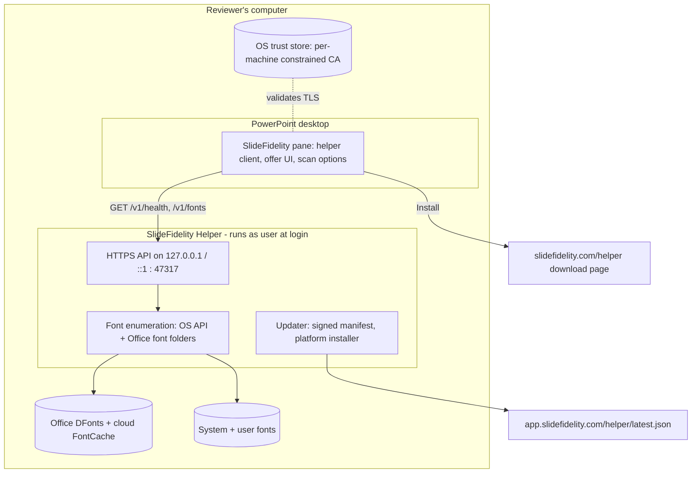
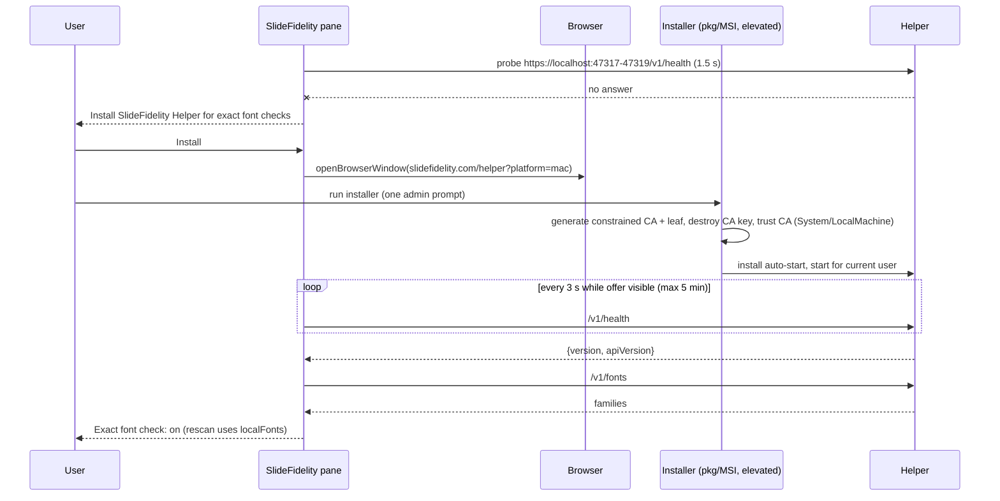
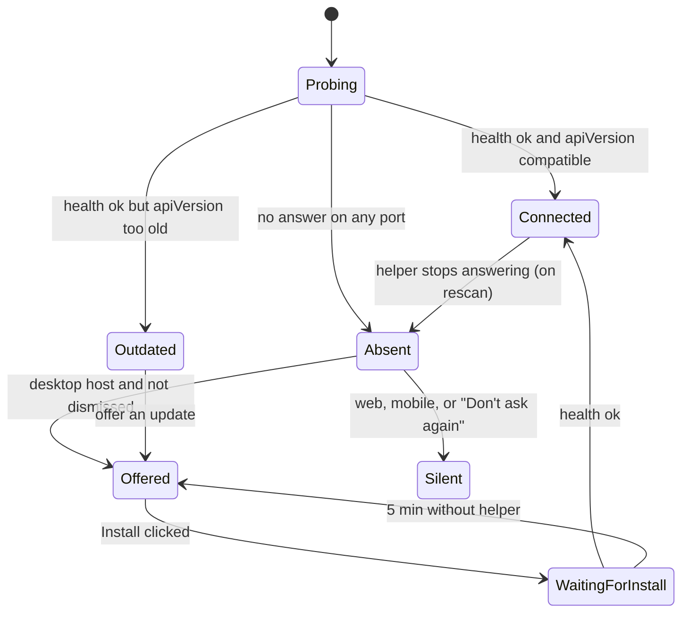

# SlideFidelity Helper - Plan

---

## Goal Capsule

- **Objective:** A Graphics Ops reviewer using PowerPoint for Mac or Windows sees exactly which fonts in a deck PowerPoint on this computer cannot use, including fonts the user installed and fonts that ship inside Office. They no longer maintain a font list by hand. Getting the helper takes one click in the SlideFidelity pane and one installer prompt. Managed show machines get it silently.
- **Means:** An optional, signed Rust background app ("SlideFidelity Helper") serves the computer's font families over HTTPS on localhost, using a machine-specific trusted certificate. The SlideFidelity add-in detects it, uses it, offers it when absent, and falls back to the imported show-machine list (KTD1–KTD4).
- **Authority hierarchy:** Product Contract Requirements win on behavior. KTDs win on mechanism. Units implement; they never amend an R or KTD. `docs/notes/review-decisions.md` (G1–G6) remains authoritative for existing add-in behavior.
- **Stop conditions:** Stop and ask when any of these happens:
  - The U1 spike shows PowerPoint for Mac rejects both certificate designs.
  - The Office private font folders cannot be read without a privacy prompt.
  - The U2 spike shows Windows PowerPoint cannot reach the helper.
  - Apple or Microsoft signing accounts are unavailable.
- **Execution profile:** Deep and phased: A (spikes and gates), B (helper core), C (packaging and release), D (add-in and site). Phase A gates everything else. The helper is test-first. Packaging is proved with install smoke tests on real machines.
- **Tail ownership:** The implementer owns code, CI, and packaging scripts. The user owns the Apple Developer ID Installer certificate, Azure Artifact Signing setup, the Windows test machine, the download-page domain, and AppSource submission.

---

## Product Contract

### Summary

Build SlideFidelity Helper, a small background app for macOS and Windows. It starts at login, listens only on this computer, and answers one question for the SlideFidelity add-in: which font families PowerPoint can use here. That covers operating-system fonts, user-installed fonts, and Microsoft Office's private and cloud fonts.

The add-in detects the helper when the pane opens and reports fonts missing on this computer exactly. When the helper is absent, the add-in offers to install it. When the user declines, or on PowerPoint on the web, the add-in falls back to the imported show-machine font list. The helper updates itself, and administrators can deploy it silently with Jamf or Intune.

### Problem Frame

Graphics Ops must know before a show whether a deck's fonts will render on the presenting computer. Today SlideFidelity can only compare fonts against a hand-imported list.

On this session's Mac, two in-pane approaches failed:

- A canvas probe could see only built-in macOS fonts.
- Plain HTTP to a local service was blocked as mixed content.

HTTPS to localhost with a trusted certificate did work (`docs/notes/office-js-platform-behavior.md`). A native helper is the only way to read the real font set PowerPoint uses, including Office's private fonts. Those live in `PowerPoint.app/Contents/Resources/DFonts` and Office's cloud font cache, where macOS does not register them for other apps.

### Key Decisions

- **A companion helper, not a standalone desktop app or a VSTO add-in.** It keeps the in-PowerPoint workflow: Show in PowerPoint, the Inspector, and in-place fixes. (session-settled: user-approved — chosen over a standalone desktop app and a classic Windows add-in: keeps the in-PowerPoint review flow, works on Mac.) Governs R1–R6.
- **Offer the install automatically from the pane.** (session-settled: user-directed — chosen over manual discovery of the helper: the user asked for an automatic offer.) Governs R5, R6.
- **Desktop only. PowerPoint on the web falls back.** (session-settled: user-directed — chosen over also supporting the web: Chrome's local-network permission and iframe delegation make the web unreliable.) Governs R3, R5.
- **Exact local check plus the show-machine list, kept separate.** "Missing on this computer" comes from the helper. "Not on the show-machine list" comes from the imported list. A one-click "Add this computer's fonts to the show-machine list" replaces running `tools/list-fonts-*.{py,ps1}` by hand. This is an agent proposal; see Assumptions. Governs R2, R15.

### Requirements

**Detection and use**

- R1. Within 2 s of the pane opening on PowerPoint for Mac or Windows, SlideFidelity knows whether a compatible helper is running, without any prompt. The helper status is visible in Settings and in the Problems Fonts row.
- R2. With the helper running, a font used in the deck that is not embedded and that PowerPoint on this computer cannot use is reported as "Missing on this computer". The check covers OS-registered fonts, user-installed fonts, and Office private and cloud fonts. A font PowerPoint can use is never reported missing on this computer.
- R3. Without a reachable helper, SlideFidelity behaves as today. It uses the show-machine list, the Office cross-platform list, and embedding. It shows no errors.
- R4. When the helper's font list changes, for example after the user installs a font, a rescan reflects it without restarting PowerPoint.

**Offer and install**

- R5. When no helper is found on desktop Mac or Windows, the Problems Fonts row and Settings offer "Install SlideFidelity Helper for exact missing-font checks". Choices are Install, Not now, and Don't ask again.
  - Install opens the slidefidelity.com download page for the detected platform in the browser, using `openBrowserWindow`.
  - The offer never appears on PowerPoint on the web, iPad, or mobile.
- R6. After the user installs the helper, the open pane detects it within 10 s and switches to the exact check without a reload.
- R7. Interactive install needs at most one administrator authorization: the installer's own prompt. Installs through Jamf (pkg) and Intune (MSI) need none.
- R8. The helper's TLS certificate is unique per computer. It is valid only for `localhost`, `127.0.0.1`, and `::1`, and it cannot be used to impersonate any other site.
- R9. The helper starts automatically at login and uses little memory and CPU when idle.
- R10. The helper updates itself from a signed feed. Administrators can turn updates off and deliver new versions through Jamf or Intune instead.
- R11. Uninstalling removes the helper, its auto-start entry, its certificate trust, and its files.

**Security and privacy**

- R12. The helper listens only on loopback addresses. It answers only allowlisted SlideFidelity origins and rejects every other origin and any non-loopback `Host`.
- R13. The helper returns only font family names and its own version and status. It never reads presentations and sends nothing off the computer, except fetching its own update feed.

**Disclosure and convenience**

- R14. The AppSource listing, the privacy page, and the certification notes disclose the optional helper: what it installs, what it reads, and that exact font checks depend on it.
- R15. With the helper running, Settings offers "Add this computer's fonts to the show-machine list", which merges the helper's list into the existing store.

### Acceptance Examples

- AE1. Covers R2.
  - **Given** Gotham is installed in `~/Library/Fonts`, Aptos exists only inside Office, a deck uses Gotham, Aptos, and "Futura PT", and the helper is running,
  - **When** the user scans,
  - **Then** only Futura PT is reported "Missing on this computer".
- AE2. Covers R5, R6.
  - **Given** no helper on a Mac,
  - **When** the user opens SlideFidelity and selects Install, then completes the installer,
  - **Then** within 10 s the Fonts row shows "Exact font check: on", with no pane reload.
- AE3. Covers R3, R5.
  - **Given** PowerPoint on the web,
  - **When** the user opens the pane,
  - **Then** no helper offer appears and font checks use the show-machine list.
- AE4. Covers R12.
  - **Given** the helper is running,
  - **When** a web page at https://example.com calls `https://localhost:<port>/v1/fonts`,
  - **Then** the helper returns 403 and no font data.

### Success Criteria

- On the user's Mac and Windows test machines, AE1 holds for a deck covering system, user-installed, Office-only, and absent fonts.
- From a fresh install to "Exact font check: on" takes under 1 minute, with exactly one administrator prompt interactively and none through MDM.
- An idle helper uses under 30 MB of memory and is below 1% CPU.

### Scope Boundaries

**Deferred for later**

- File-level fixes through the helper: cleaned copies, image compression, hidden-list-style removal, turning off Header & Footer slide numbers.
- Batch review of several decks through the helper.
- PowerPoint on the web support, through Chrome Local Network Access.

**Outside this product's identity**

- Requiring the helper for any core feature.
- Any data collection by the helper.

### Dependencies

- Rust toolchain: not installed on the dev Mac yet. Install through rustup with the `aarch64-apple-darwin` and `x86_64-apple-darwin` targets.
- Apple certificates:
  - Developer ID Application "Goran Draskovic (XM4M8R6AVA)" and the `notary` notarytool profile already exist (from the GetAudienceResponse project).
  - A **Developer ID Installer** certificate is also required to sign the `.pkg`, and may not exist yet.
- Azure Artifact Signing for Windows Authenticode: not configured yet. GetAudienceResponse's `GAR_SIGNING_PROFILE` was never set.
- A Windows machine with Microsoft 365 PowerPoint (the user has one) for U2 and Windows testing.
- Hosting for `https://slidefidelity.com/helper/` (download page) and `https://app.slidefidelity.com/helper/latest.json` (update feed), on the same Cloudflare Pages projects as the site and add-in.

### Sources

- `docs/notes/office-js-platform-behavior.md`: real-host results for PowerPoint for Mac 16.113. These cover the scan, the canvas font probe, and HTTP vs HTTPS reachability of a local helper.
- `tools/list-fonts-mac.py` and `tools/list-fonts-windows.ps1`: the font-source paths and enumeration logic to port.
- Microsoft certification policies (100.4, 100.1.3, 100.11, 1120.2): https://learn.microsoft.com/en-us/legal/marketplace/certification-policies. Researched; re-check the quotes before submission.
- Apple: certificates from user- or admin-added roots are exempt from the 398-day TLS validity limit (https://support.apple.com/en-us/102028).
- Chrome Private and Local Network Access: https://developer.chrome.com/blog/private-network-access-preflight

---

## Planning Contract

### Key Technical Decisions

- KTD1. **Rust single codebase.** It produces one small native binary per platform with no runtime. Crates:
  - `axum` with `axum-server` (`tls-rustls`) and `tower-http` (cors);
  - `rustls` with the `ring` provider, to avoid NASM on Windows CI;
  - `rcgen` 0.14 for certificates;
  - `ttf-parser` 0.25 for Office font files;
  - `objc2-core-text` for macOS and the `windows` crate (DirectWrite, Cryptography) for Windows;
  - `minisign-verify` for update signatures;
  - `reqwest` (rustls) and `directories`.

  (session-settled: user-directed — chosen over Go and native-per-platform: user preference for Rust's footprint and safety.)
- KTD2. **HTTPS on loopback with a machine-specific trust anchor.**
  - Preferred design: a per-machine private CA whose critical `NameConstraints` permit only `localhost`, `127.0.0.1/32`, and `::1/128`. The CA signs one leaf with a long validity (10 years). The CA private key is destroyed immediately after signing, so even a stolen root can sign nothing else.
  - Fallback, if U1 shows WKWebView or WebView2 rejects the constrained chain: a self-signed leaf with the same SANs, trusted with the SSL policy only.
  - Long validity is allowed because user- and admin-added roots are exempt from the 398-day limit. It avoids re-prompting.

  (session-settled: user-approved — chosen over plain HTTP to 127.0.0.1: the Mac spike showed HTTP is blocked as mixed content.)
- KTD3. **Trust through the installer's elevation.**
  - Mac: the `.pkg` postinstall runs as root and calls `security add-trusted-cert -d -r trustRoot -p ssl -k /Library/Keychains/System.keychain`.
  - Windows: a per-machine MSI deferred custom action adds the certificate to `LocalMachine\Root`.
  - The installer's own authorization is the single prompt (R7). Jamf and Intune run these as root or SYSTEM, silently.
- KTD4. **Auto-start through the installer.**
  - Mac: `/Library/LaunchAgents/com.slidefidelity.helper.plist` (`RunAtLoad`, `KeepAlive`), bootstrapped for the console user in postinstall. Jamf can pre-approve it with a managed login items profile.
  - Windows: an `HKLM\...\Run` entry from the MSI.
  - No runtime auto-launch crate.
- KTD5. **Built-in signed updater.**
  - The helper checks `https://app.slidefidelity.com/helper/latest.json` at start and every 24 h. The manifest holds `version`, `platform` URLs, `sha256`, and a minisign signature verified against a public key compiled into the binary.
  - Updates install through the platform installer: a notarized, stapled `.pkg` via `installer -pkg`, run by a tiny privileged path only the pkg sets up, or an MSI major upgrade via `msiexec /i … /qn`. The binary is never replaced in place, because that would break the Mac code-signature seal.
  - MDM can disable updates through a managed preference (`com.slidefidelity.helper` `AutoUpdate=false`) or the registry (`HKLM\Software\SlideFidelity\Helper\AutoUpdate=0`).
  - (session-settled: user-directed — chosen over store or package-manager updates and manual updates: the user chose a built-in signed updater.)
  - The exact privileged-update mechanism on Mac is settled in U7. See Open Questions.
- KTD6. **Font sources.**
  - Mac: `CTFontCollectionCreateFromAvailableFonts` gives English and localized family names, and `ttf-parser` scans `PowerPoint.app/Contents/Resources/DFonts` and `~/Library/Group Containers/UBF8T346G9.Office/FontCache`.
  - Windows: DirectWrite `GetSystemFontCollection`, including per-user fonts, plus `ttf-parser` over `%ProgramFiles%\Microsoft Office\root\vfs\Fonts\private` and `%LOCALAPPDATA%\Microsoft\FontCache\4\CloudFonts`.
  - Handle `.ttc` and `.otc` collections, sniff magic bytes, and skip unparseable files.
  - Return name IDs 1, 16, and 21 across all languages, deduplicated per family.
  - The helper runs as the logged-in user, so per-user folders resolve.
- KTD7. **The API is versioned, read-only, and origin-locked.**
  - Endpoints: `GET /v1/health` returns `{version, apiVersion, platform}`. `GET /v1/fonts` returns `{families:[{name, names[], sources[]}], generatedAt}`.
  - Every request is rejected with 403 unless `Origin` is in the allowlist (`https://app.slidefidelity.com`; plus `https://localhost:3000` in debug builds only) and `Host` is a loopback name with the helper's port.
  - It answers Private Network Access preflights, and sets `Vary: Origin` and `Cache-Control: no-store`.
  - No token in v1: the data is font names only, and local processes can already read the font folders. Add pairing before any endpoint returns anything beyond font families.
- KTD8. **Fixed port with fallbacks.** The helper uses the first free port of `47317, 47318, 47319`, recorded in a state file. The add-in probes the three in parallel with a 1.5 s timeout each.
  - The production add-in CSP adds `connect-src https://localhost:47317 https://localhost:47318 https://localhost:47319`. The manifest needs no AppDomain for `fetch`.
- KTD9. **Audit-engine semantics.** A new `AuditOptions.localFonts?: string[]` carries the helper's family names. It is kept separate from `availableFonts` (the show-machine list).
  - `font-maybe-missing` gains `missingHere: boolean | null` (null when no helper).
  - A new warning kind, `font-missing-here`, reports only the fonts the helper proves absent.
  - The Problems view counts `font-missing-here` as a problem. When the helper is present, the show-machine finding is shown as a note.

### High-Level Technical Design

Components:



Install, detection, and use:



Pane helper-state machine:



### Output Structure

```text
helper/                         # new Rust crate (KTD1), outside the npm workspace
  Cargo.toml
  src/main.rs                   # CLI: serve | install-cert | uninstall-cert | fonts | version
  src/server.rs                 # axum app, origin/host guards, PNA
  src/fonts/{mod,mac,windows,office}.rs
  src/cert.rs                   # rcgen chain, trust/untrust per OS
  src/update.rs                 # manifest, minisign, installer handoff
  src/config.rs                 # ports, paths, managed prefs
  tests/                        # unit + integration (font fixtures, TLS client tests)
  packaging/mac/{build.sh,scripts/postinstall,scripts/preinstall,com.slidefidelity.helper.plist,uninstall.sh,distribution.xml}
  packaging/windows/{helper.wxs,build.ps1}
.github/workflows/helper-release.yml
apps/addin/src/helper/{client.ts,useHelper.ts,offer.tsx}   # + tests
packages/audit-core/src/checks/fontAvailability.ts        # localFonts semantics (modified)
apps/site/src/helper.html                                  # download page
```

### Assumptions

- The "missing on this computer" and "not on the show-machine list" split (Key Decision 4) is an agent proposal. Both signals are cheap, and the UI can collapse them later.
- Office's cloud font cache is readable by a process running as the user without a privacy prompt. U1 verifies this. If it is wrong, the helper falls back to the OS API plus `DFonts`, and the add-in marks cloud fonts "unknown here".
- No pairing token is needed in v1 (KTD7 threat model). Revisit if the API grows.
- The leaf private key is readable by every local user on both platforms, because each user's helper must serve TLS. Another local user could impersonate the helper to the add-in and feed it a wrong font list. That user could already alter fonts on the machine, so this is accepted for a font-list-only API.
- On a Mac with several accounts logged in at once, only the first helper gets port 47317, and the others take 47318 and 47319. The add-in probes all three, so each user's pane may reach another user's helper. Fonts in `/Library/Fonts` and Office's folders are shared, but `~/Library/Fonts` is per user. Accepted for v1. Record it in U1 and revisit if Graphics Ops uses shared Macs.
- Ports 47317–47319 are free on typical machines. The fallback list covers collisions.

### Open Questions

- OQ1 (deferred to U7). On Mac, how does an unprivileged helper apply a pkg update that needs root? There are three options:
  - A launchd-triggered privileged updater installed by the pkg, with a narrow command.
  - Showing the macOS installer UI to the user, which adds a prompt per update.
  - Defaulting updates to "notify" on unmanaged Macs.

  U7 picks one, and that decides whether updates are silent on unmanaged Macs. Not blocking.
- OQ2 (deferred to U2). Does WebView2 in Office honor a `LocalMachine\Root` constrained CA without extra policy? The U2 spike answers it.

### Sequencing

A (U0 → U1 ∥ U2) gates everything else. Then B (U3 → U4 ∥ U5 ∥ U6 → U7). Then C (U8 ∥ U9 → U10). Then D (U11 → U12 → U13).

U11 and U12 can start once U5's API contract is fixed, in parallel with C.

---

## Implementation Units

| U-ID | Title | Key files | Depends on |
|---|---|---|---|
| U0 | Toolchains and signing prerequisites | `helper/README.md` | — |
| U1 | Mac trust and font-access spike | `helper/spikes/mac/` | U0 |
| U2 | Windows reachability and trust spike | `helper/spikes/windows/` | U0 |
| U3 | Helper crate skeleton and CLI | `helper/src/main.rs`, `config.rs` | U1 |
| U4 | Font enumeration | `helper/src/fonts/*` | U3 |
| U5 | HTTPS API with origin and host guards | `helper/src/server.rs` | U3, U6 |
| U6 | Certificate lifecycle | `helper/src/cert.rs` | U3 |
| U7 | Signed updater | `helper/src/update.rs` | U3 |
| U8 | Mac packaging, notarization, MDM notes | `helper/packaging/mac/*` | U4–U7 |
| U9 | Windows MSI, signing, Intune notes | `helper/packaging/windows/*` | U2, U4–U7 |
| U10 | Release pipeline and update feed | `.github/workflows/helper-release.yml` | U8, U9 |
| U11 | Audit engine: local fonts semantics | `packages/audit-core/src/checks/fontAvailability.ts` | — |
| U12 | Add-in helper client, offer, and status | `apps/addin/src/helper/*` | U5, U11 |
| U13 | Download page, disclosure, docs | `apps/site/src/helper.html`, release docs | U10, U12 |

### U0. Toolchains and signing prerequisites

**Goal:** Every build and signing prerequisite exists before code depends on it.

**Requirements:** R7, R10 (enablers); KTD1.

**Dependencies:** none.

**Files:** `helper/README.md` (prerequisites and the build matrix).

**Approach:**
1. Install rustup with stable plus the `aarch64-apple-darwin` and `x86_64-apple-darwin` targets.
2. The user creates a **Developer ID Installer** certificate on developer.apple.com and confirms the existing `notary` profile works.
3. The user sets up Azure Artifact Signing, with organization verification and a certificate profile, for Windows. Record the profile name for CI secrets.
4. Create the minisign key pair for update signing. The private key goes into CI secrets only.

**Execution note:** Configuration only. Prove it with `cargo --version`, `security find-identity -v -p basic` (lists both Developer ID identities), a test `notarytool history`, and a signed hello-world MSI.

**Test scenarios:** Test expectation: none -- tooling and accounts.

**Verification:** All four checks above succeed. The README documents them.

### U1. Mac trust and font-access spike (gate)

**Goal:** Prove, inside PowerPoint for Mac, the certificate design (KTD2) and the font access (KTD6) before building the helper.

**Requirements:** R2, R8; KTD2, KTD6.

**Dependencies:** U0.

**Files:** `helper/spikes/mac/` (throwaway Rust binary plus a results note appended to `docs/notes/office-js-platform-behavior.md`).

**Approach:**
1. Generate a per-machine CA with critical `NameConstraints` (`localhost`, `127.0.0.1/32`, `::1/128`). Sign a leaf with SANs `localhost`, `127.0.0.1`, and `::1`. Destroy the CA key.
2. Trust the CA in the System keychain with `-p ssl`. Serve `/v1/health` from a minimal axum server on 47317.
3. Reuse the dev-only pane diagnostic from commit `73da3ed`, pointed at `https://localhost:47317`. Record the result.
4. If step 3 fails, repeat with a self-signed leaf trusted with `-p ssl` (the KTD2 fallback).
5. Run the spike as a LaunchAgent, not from Terminal, which may hold Full Disk Access. List families from `DFonts` and the Group Container `FontCache`, and note any privacy prompt.
6. Check the per-install experience: how many prompts appear when the trust step runs from a pkg postinstall as root.

**Execution note:** This is a gate. Stop and ask if neither certificate design works, or if a privacy prompt appears.

**Test scenarios:** Test expectation: none -- spike. Its outcome is recorded evidence.

**Verification:** The notes record pass or fail for each design, the font-access result, and the prompt count. The KTD2 choice is confirmed.

### U2. Windows reachability and trust spike (gate)

**Goal:** Prove that the Windows PowerPoint pane (WebView2) reaches an HTTPS loopback helper trusted through `LocalMachine\Root`, and that Office private and cloud fonts are readable.

**Requirements:** R2, R8; KTD2, KTD3, KTD6.

**Dependencies:** U0.

**Files:** `helper/spikes/windows/`, with notes appended to `docs/notes/office-js-platform-behavior.md`.

**Approach:**
1. On the user's Windows machine, sideload the dev add-in with `npm run start` and its own dev certificates.
2. Run the U1 spike binary built for Windows. Add the constrained CA to `LocalMachine\Root` from an elevated prompt, then test from the pane.
3. Also test `CurrentUser\Root`, for the record.
4. Check that binding to loopback only causes no firewall prompt.
5. List fonts through DirectWrite and the two Office folders. Compare against `tools/list-fonts-windows.ps1`.

**Execution note:** This is a gate for U9 and the Windows part of U4.

**Test scenarios:** Test expectation: none -- spike.

**Verification:** The notes record the WebView2 result per trust store, the firewall behavior, and the font-list parity. OQ2 is answered.

### U3. Helper crate skeleton and CLI

**Goal:** A `helper/` Rust crate with the CLI, configuration, logging, and the platform-specific path layout.

**Requirements:** R9, R11, R12; KTD1, KTD8.

**Dependencies:** U1.

**Files:**
- `helper/Cargo.toml`, `helper/src/main.rs`, `helper/src/config.rs`, `helper/src/paths.rs`
- `helper/tests/cli.rs`

**Approach:**
1. Subcommands:
   - `serve`, the default and run by auto-start;
   - `install-cert` and `uninstall-cert`, run by the installers as root or SYSTEM;
   - `fonts`, which prints JSON for debugging;
   - `version`.
2. Paths:
   - Mac state: `/Library/Application Support/SlideFidelity/Helper/` (machine-wide). The installer creates the certificate once, as root, and every user account on the Mac runs its own helper with it. The leaf certificate is readable by all; the leaf key is readable by all and writable by root only. A per-user location would break the helper for every account except the installer's.
   - Per-user runtime data (logs, chosen port): `~/Library/Application Support/SlideFidelity/Helper/`.
   - Windows state: `%ProgramData%\SlideFidelity\Helper\`, ACL'd to SYSTEM, Administrators, and Users read for the certificate, and the key readable by Users. Note: the key is per machine.
3. Managed preferences:
   - Mac: `CFPreferences` domain `com.slidefidelity.helper`.
   - Windows: `HKLM\Software\SlideFidelity\Helper`.
   - Settings: `AutoUpdate` and `Port`.
4. Logging uses `tracing`, written to a rotating file in the state directory.

**Test scenarios:**
- Happy: `slidefidelity-helper version` prints the semver and API version.
- Happy: path resolution per platform returns the documented directories (cfg-gated tests).
- Edge: a missing state directory is created with the right permissions.
- Error: an unknown subcommand exits non-zero with usage text.

**Verification:** `cargo test` passes on mac and Windows CI. `cargo clippy -D warnings` is clean.

### U4. Font enumeration

**Goal:** Return every font family PowerPoint can use on this computer (KTD6).

**Requirements:** R2, R4, R13; KTD6; AE1.

**Dependencies:** U3 (Windows part also gated by U2).

**Files:**
- `helper/src/fonts/{mod.rs,mac.rs,windows.rs,office.rs}`
- `helper/tests/fonts.rs`
- `helper/tests/fixtures/fonts/` (small open-licensed `.ttf`/`.otf`/`.ttc` fixtures with localized names)

**Approach:**
1. `FontInventory { families: BTreeMap<key, Family { name, names: Vec<String>, sources: Set<os|user|office|cloud> }> }`, keyed by case-folded English family name.
2. OS layer per platform (KTD6).
3. The Office layer walks the configured folders, sniffs magic bytes, and parses every face in collections with `ttf-parser`, reading name IDs 1, 16, and 21 in all languages.
4. Cache in memory. Recompute when a folder's mtime changes or every 10 minutes, so R4 holds without a restart.

**Execution note:** Test-first for the Office layer with fixtures. The OS layers are proved by comparing against `tools/list-fonts-mac.py` and `tools/list-fonts-windows.ps1` on real machines.

**Test scenarios:**
- Happy: a fixture folder with a `.ttf`, an `.otf`, and a 2-face `.ttc` yields 3 families with their English names.
- Happy: a fixture with Japanese and English name records exposes both in `names`, keyed by English.
- Edge: a file with no extension but valid `OTTO` magic is parsed. A WOFF or garbage file is skipped and logged without failing.
- Edge: a typographic family (ID 16) with style subfamilies groups under one family.
- Integration (macOS CI): the inventory includes `Helvetica Neue`. On the dev Mac, it matches `tools/list-fonts-mac.py` output with zero missing families.
- Integration (Windows CI): the inventory includes `Segoe UI`. On the test PC, it matches the PowerShell script.

**Verification:** Parity with the Python and PowerShell scripts on the two real machines. Fixture tests pass in CI.

### U5. HTTPS API with origin and host guards

**Goal:** Serve `/v1/health` and `/v1/fonts` over TLS on loopback with the KTD7 guards.

**Requirements:** R1, R12, R13; KTD7, KTD8; AE4.

**Dependencies:** U3, U6 (for the certificate).

**Files:** `helper/src/server.rs`, `helper/tests/server.rs`.

**Approach:**
1. Use axum with axum-server rustls (ring). Bind `127.0.0.1` and `::1` on the first free port of 47317–47319, and write the chosen port to the state directory.
2. Guard middleware runs before routing:
   - `Origin` must be in the allowlist (debug builds add `https://localhost:3000`), otherwise 403;
   - `Host` must be `localhost`, `127.0.0.1`, or `[::1]` with the bound port, otherwise 403;
   - only GET and OPTIONS are allowed.
3. Answer OPTIONS preflights with CORS and `Access-Control-Allow-Private-Network: true`. Set `Vary: Origin`, `Cache-Control: no-store`, and `X-Content-Type-Options: nosniff`.
4. Without a usable certificate, `serve` logs the problem and exits non-zero. Auto-start retries.

**Execution note:** Test-first. These guards are the security boundary.

**Test scenarios:**
- Happy: a request with `Origin: https://app.slidefidelity.com` and `Host: localhost:47317` gets 200 with font JSON.
- Error (AE4): `Origin: https://example.com` gets 403 with an empty body. A missing Origin gets 403.
- Error (DNS rebinding): `Host: evil.example:47317` gets 403 even with an allowed Origin.
- Happy: the preflight carries `Access-Control-Allow-Private-Network: true` and the allowed origin.
- Edge: a release build rejects `https://localhost:3000`. A debug build accepts it.
- Edge: with port 47317 taken, the server binds 47318 and records it.
- Error: POST returns 405.
- Integration: a rustls client trusting the generated CA connects to `localhost`, `127.0.0.1`, and `::1`. A client using a different SNI name fails validation.

**Verification:** Tests pass. A manual check from the add-in pane on Mac (U1 diagnostics) returns fonts.

### U6. Certificate lifecycle

**Goal:** Generate, trust, rotate, and remove the machine-specific trust anchor (KTD2, KTD3).

**Requirements:** R7, R8, R11; KTD2, KTD3.

**Dependencies:** U3.

**Files:** `helper/src/cert.rs`, `helper/tests/cert.rs`.

**Approach:**
1. `install-cert`, run as root or SYSTEM by the installer:
   - generate the constrained CA and a leaf (or the self-signed leaf, if U1 chose the fallback);
   - write the leaf certificate and key to the state directory;
   - trust the CA: on Mac, `security add-trusted-cert -d -r trustRoot -p ssl -k System.keychain`; on Windows, `CertAddEncodedCertificateToStore` into `LocalMachine\Root`;
   - zero and drop the CA key;
   - record the CA's SHA-256 thumbprint.
2. Make it idempotent: if a valid, trusted chain already exists, do nothing.
3. Rotation: when the leaf has under 1 year left, the next install or update regenerates the chain and re-trusts it through the installer's elevation, then removes the old root by thumbprint.
4. `uninstall-cert` removes the root by thumbprint and deletes the files.

**Test scenarios:**
- Happy: the generated leaf has SANs exactly `localhost`, `127.0.0.1`, and `::1`, EKU serverAuth, and validity of 10 years or less.
- Happy: the CA has `NameConstraints` (critical) permitting only those names and IPs, and its key is not persisted anywhere on disk.
- Edge: running `install-cert` twice leaves exactly one trusted root.
- Error: trust-store failure (simulated) exits non-zero with a clear message, and no orphan files remain.
- Integration (cfg macOS, CI keychain): after install, `security verify-cert -p ssl -s localhost` succeeds. After uninstall, the root is gone.
- Integration (cfg Windows CI, elevated runner): the root appears in `LocalMachine\Root` and is removed by uninstall.

**Verification:** Tests pass. Install and uninstall on both real machines leave no stray certificates.

### U7. Signed updater

**Goal:** Keep helpers current without breaking signatures, and respect the MDM opt-out (KTD5).

**Requirements:** R10; KTD5; OQ1.

**Dependencies:** U3.

**Files:** `helper/src/update.rs`, `helper/tests/update.rs`.

**Approach:**
1. At start and every 24 h, skipped when `AutoUpdate=false`: fetch `latest.json`, verify the minisign signature against the embedded public key, compare versions, download the platform package, and verify its SHA-256.
2. Windows: launch `msiexec /i <msi> /qn` (major upgrade). The MSI's elevation applies on per-machine installs. Intune-managed machines set `AutoUpdate=0`.
3. Mac (resolve OQ1 here): recommended is a root LaunchDaemon `com.slidefidelity.helper.updater`, installed by the pkg. It watches a drop folder writable only by the helper's user, and runs `installer -pkg` only for packages signed by the SlideFidelity Developer ID Installer identity (`pkgutil --check-signature`) with a matching SHA-256 from a verified manifest. Fallback: notify-only on unmanaged Macs.
4. Before any download, the add-in can show "Helper update available" through `/v1/health`.

**Execution note:** Test-first for the manifest and signature logic. The installer handoff is proved by an end-to-end upgrade on both machines.

**Test scenarios:**
- Happy: a valid manifest with a newer version triggers download and handoff (mock HTTP and installer).
- Error: a bad signature, an older version, a SHA mismatch, or a non-HTTPS URL each cause no handoff and a logged reason.
- Edge: `AutoUpdate=false` makes no network call.
- Error (Mac daemon): a package signed by another identity is rejected by the updater daemon's check.
- Integration: an upgrade from v0.1.0 to v0.1.1 on both machines preserves the certificate state and auto-start, and needs no prompt on Windows per-machine or on Mac with the daemon.

**Verification:** Tests pass. The two-version upgrade works on both real machines.

### U8. Mac packaging, notarization, and MDM notes

**Goal:** A notarized, stapled `.pkg` that installs the helper, certificate trust, the LaunchAgent, and the updater daemon with one prompt. Also an uninstall script.

**Requirements:** R7, R9, R11; KTD3, KTD4.

**Dependencies:** U4–U7.

**Files:**
- `helper/packaging/mac/{build.sh,distribution.xml,com.slidefidelity.helper.plist,com.slidefidelity.helper.updater.plist}`
- `helper/packaging/mac/scripts/{preinstall,postinstall}`
- `helper/packaging/mac/uninstall.sh`
- `helper/packaging/mac/README-jamf.md`

**Approach:**
1. Build:
   - build `lipo` universal binaries;
   - `codesign --options runtime --timestamp` with Developer ID Application;
   - `pkgbuild` with an install location of `/Library/Application Support/SlideFidelity/Helper`;
   - `productbuild --sign "Developer ID Installer"`;
   - `notarytool submit --wait` with the `notary` profile, then `stapler staple`.
2. Postinstall:
   - run `slidefidelity-helper install-cert`;
   - install both plists;
   - `launchctl bootstrap gui/<console uid>` for the agent and `system` for the daemon.
3. Preinstall stops the old agent.
4. The Jamf README covers: deploy the pkg, and the managed login items profile (`com.apple.servicemanagement`) so users see no "Background Items" toggle surprise.

**Execution note:** Packaging. Prove it with install, uninstall, and reinstall smoke tests on the dev Mac and a clean macOS VM.

**Test scenarios:** Test expectation: none -- packaging. Covered by the smoke checklist in Verification.

**Verification:**
- `spctl -a -vv -t install` accepts the pkg.
- A fresh install shows exactly one authorization prompt.
- The helper answers within 10 s after install.
- After a reboot, the helper is running.
- Uninstall leaves no files, plists, or trusted roots.

### U9. Windows MSI, signing, and Intune notes

**Goal:** A signed per-machine MSI that installs the helper, trusts the certificate, adds the auto-start entry, and supports silent Intune deployment.

**Requirements:** R7, R9, R11; KTD3, KTD4.

**Dependencies:** U2, U4–U7.

**Files:** `helper/packaging/windows/{helper.wxs,build.ps1,README-intune.md}`.

**Approach:**
1. Build the MSI with WiX (cargo-wix or WiX v4 CLI). Per-machine scope. Install to `%ProgramFiles%\SlideFidelity\Helper`.
2. Elevated deferred custom actions: `install-cert` on install, `uninstall-cert` on remove.
3. Add the `HKLM\...\Run` entry `"slidefidelity-helper.exe" serve`. Start the helper for the installing user at the end of install.
4. Sign `slidefidelity-helper.exe` and the MSI with `signtool` through Azure Artifact Signing.
5. The Intune README covers: a line-of-business app with `msiexec /i … /qn`, the detection rule, and `AutoUpdate=0` through the registry when Intune manages updates.

**Execution note:** Packaging. Prove it on the user's Windows machine.

**Test scenarios:** Test expectation: none -- packaging. Covered by the Verification smoke checklist.

**Verification:**
- SmartScreen shows the publisher.
- A fresh install shows one UAC prompt.
- `msiexec /qn` as SYSTEM shows none.
- The helper answers the pane within 10 s.
- Uninstall removes the root, the Run key, and the files.

### U10. Release pipeline and update feed

**Goal:** Tagged releases build, sign, notarize, and publish both installers and a signed `latest.json`.

**Requirements:** R7, R10, R14 (enablers); KTD5.

**Dependencies:** U8, U9.

**Files:**
- `.github/workflows/helper-release.yml`
- `helper/packaging/make-manifest.sh`
- `apps/addin/public/helper/` (feed published with the add-in Pages build) or the `apps/site` equivalent

**Approach:**
1. Trigger on `helper-v*` tags.
2. Mac job (`macos-14`): import certificates into a temporary keychain from secrets, run the U8 build, notarize.
3. Windows job: run the U9 build and Azure signing.
4. Publish job: attach the artifacts to a GitHub release, then generate `latest.json`, sign it with minisign from secrets, and deploy it to `app.slidefidelity.com/helper/latest.json`.
5. Mirror the GetAudienceResponse download-proxy pattern on the site if useful.

**Test scenarios:** Test expectation: none -- CI configuration. A dry-run tag on a fork produces signed, notarized artifacts and a verifiable manifest.

**Verification:** The dry-run release passes `spctl` and `signtool verify`, and `minisign -V` verifies the manifest.

### U11. Audit engine: local fonts semantics

**Goal:** Use the helper's list for exact "missing on this computer" findings, separate from the show-machine list (KTD9).

**Requirements:** R2, R3; KTD9; AE1.

**Dependencies:** none (can start immediately).

**Files:**
- `packages/audit-core/src/runner.ts` (add `localFonts?: string[]`)
- `packages/audit-core/src/checks/fontAvailability.ts`
- `packages/audit-core/test/checks/fontAvailability.test.ts`

**Approach:**
1. When `localFonts` is present, a used, non-embedded family not in `localFonts` (matched case-insensitively against all names) emits `font-missing-here`. This is a warning with the same targets and fixes as `font-maybe-missing`.
2. `font-maybe-missing` gains `missingHere`, and drops to info when the helper proves the font present.
3. The summary adds `localListProvided` and `missingHere` counts.
4. Without `localFonts`, nothing changes (R3).

**Test scenarios:**
- Covers AE1. With `localFonts` [Gotham, Aptos, Calibri, Arial] and a deck using Gotham, Aptos, and Futura PT, only Futura PT is `font-missing-here`.
- Happy: a localized name in `localFonts` matches the deck's English name through the names list. The helper sends all names; the engine receives a flattened list.
- Edge: an embedded font is never missing here.
- Edge: absent `localFonts` gives identical findings to today (snapshot of the existing tests).
- Integration: the clean corpus deck with `localFonts` covering Office defaults has zero warnings.

**Verification:** The audit-core suite passes. The new kind is registered in the Problems model through U12.

### U12. Add-in helper client, offer, and status

**Goal:** Detect the helper, feed `localFonts`, offer installation, react to a new install, and add "Add this computer's fonts" (R1, R5, R6, R15).

**Requirements:** R1, R3, R4, R5, R6, R15; KTD8; AE2, AE3.

**Dependencies:** U5 (API contract), U11.

**Files:**
- `apps/addin/src/helper/{client.ts,client.test.ts,state.ts,state.test.ts,HelperOffer.tsx,HelperStatus.tsx}`
- `apps/addin/src/taskpane/{index.tsx,components/Problems.tsx,components/ShowFontsEditor.tsx}`
- `apps/addin/src/taskpane/fonts/showFontsStore.ts` (compose `localFonts`)
- `apps/addin/src/taskpane/model/problems.ts`
- `apps/addin/webpack.config.js` (prod CSP `connect-src` for the three localhost ports)

**Approach:**
1. `client.ts` probes the three ports in parallel with a 1.5 s timeout. It treats only an allowlisted JSON health response with a compatible `apiVersion` as Connected, then fetches `/v1/fonts`.
2. State machine per the HTD. The offer appears only when `Office.context.platform` is Mac or PC (never OfficeOnline, iOS, or Android) and the user hasn't chosen "Don't ask again" (localStorage, try/catch).
3. Install opens `https://slidefidelity.com/helper?platform=mac|windows` with `openBrowserWindow`, then polls health every 3 s for up to 5 minutes (R6).
4. The scan service's `getOptions` adds `localFonts` when Connected.
5. Problems Fonts row:
   - Connected shows "Exact font check: on (helper vX)".
   - Absent shows the offer, or "Using show-machine list".
   - `font-missing-here` counts as a problem.
6. ShowFontsEditor gets "Add this computer's fonts" when Connected.
7. Production CSP: `connect-src … https://localhost:47317 https://localhost:47318 https://localhost:47319`.

**Execution note:** Test-first for `client.ts` and the state machine with a fake fetch. The UI follows the existing D15 and Problems patterns.

**Test scenarios:**
- Happy: health 200 on 47318 → Connected, and fonts are fetched once.
- Edge: an incompatible `apiVersion` → Outdated, which offers an update.
- Error: all ports time out → Absent within 2 s total (R1). Mixed network errors don't throw to the UI.
- Covers AE3. On an OfficeOnline host, no offer ever renders and no polling happens.
- Covers AE2. Clicking Install opens the platform URL, and polling flips to Connected when health starts answering, without a reload.
- Edge: "Don't ask again" persists across reloads. Storage failure falls back to the session only.
- Integration: scan options include `localFonts` when Connected, and a rescan after a font-list change reflects it (R4).
- Happy: "Add this computer's fonts" merges into the store, dedupes, and keeps existing entries.
- Edge: the prod build's CSP contains exactly the three localhost ports and no wildcard.

**Verification:**
- Add-in tests pass.
- On the Mac with the U8 pkg installed, AE1 and AE2 pass in real PowerPoint.
- On Windows with the U9 MSI, AE1 passes.

### U13. Download page, disclosure, and docs

**Goal:** A clear download page and accurate disclosure, so users and Microsoft reviewers know what the helper does.

**Requirements:** R5, R14.

**Dependencies:** U10, U12.

**Files:**
- `apps/site/src/helper.html` and `apps/site/src/helper.js`
- `apps/site/src/privacy.html` (helper section)
- `docs/release/appsource-checklist.md` (disclosure and certification notes)
- `docs/notes/review-decisions.md` (G7 entry)

**Approach:**
1. The download page detects the platform from the query parameter and the user agent. It shows the matching signed installer with SHA-256, version, and system requirements, plus a plain explanation:
   - what is installed: an app, a login item, and a localhost-only certificate;
   - what it reads: font names only;
   - how to uninstall.
2. The page also has an "IT and MDM" section linking the Jamf and Intune READMEs.
3. The privacy page states the helper sends nothing except fetching update manifests.
4. AppSource listing text and certification notes:
   - the helper is optional and free;
   - the add-in is fully functional without it;
   - what it installs (policy 100.11);
   - the dependency is disclosed (100.4, 100.1.3);
   - no mobile link (1120.2).

**Test scenarios:** Test expectation: none -- static content. A link check plus the policy checklist review in Verification.

**Verification:** Pages build. The checklist items for the helper are ticked. The text was reviewed against the policy page quotes.

---

## Verification Contract

| Gate | Command / method | Applies to |
|---|---|---|
| Rust build and lint | `cargo build --release`, `cargo clippy -- -D warnings`, `cargo fmt --check` in `helper/` | U3–U7 |
| Rust tests | `cargo test` on macOS and Windows CI runners | U3–U7 |
| JS gates | `npm run typecheck`, `npm run lint`, `npm test` | U11, U12 |
| Add-in build | `npm run build --workspace @slidefidelity/addin`, and confirm the prod CSP contains exactly the three localhost ports | U12 |
| Mac package | `spctl -a -vv -t install`, notarization log clean, smoke checklist (U8) | U8 |
| Windows package | `signtool verify /pa`, smoke checklist (U9) | U9 |
| Release dry run | tag on a fork: signed artifacts plus a minisign-verified `latest.json` | U10 |
| Real-host acceptance | AE1, AE2, and AE4 on the dev Mac in PowerPoint; AE1 on the Windows PC; AE3 on PowerPoint for the web | U12 |

---

## Definition of Done

- R1–R15 are met. AE1–AE4 pass on real hosts as listed in the Verification Contract.
- The U1 and U2 gate results are recorded in `docs/notes/office-js-platform-behavior.md`, and the KTD2 design choice is confirmed or switched to the fallback.
- No trusted root on any test machine can sign certificates for anything other than localhost and the loopback IPs, as checked by inspecting the installed root.
- Uninstall on both platforms leaves no files, auto-start entries, or trusted roots.
- The add-in still works with no helper present (R3): the existing test suites are green, unchanged.
- The release pipeline produces signed, notarized artifacts and a signed feed.
- Dead-end spike code is removed from the main tree. The spikes live only in `helper/spikes/` until U4 and U5 land, then they are deleted.

---

## Risks & Dependencies

| Risk | Impact | Mitigation |
|---|---|---|
| WKWebView or WebView2 rejects the name-constrained CA chain | KTD2 needs the fallback | U1 and U2 test both designs before any build. The fallback self-signed leaf keeps the same SANs and SSL-only trust |
| Office cloud-font cache protected by macOS app-data protection | Missing-font false positives for cloud fonts | U1 tests from a LaunchAgent. Fallback: mark cloud fonts "unknown here" rather than missing |
| Developer ID Installer certificate or Azure Artifact Signing not available | No shippable installers | U0 runs first. Apple and Azure setup is owned by the user |
| Mac unattended updates need root | Updates prompt or stall on unmanaged Macs | OQ1 in U7: a narrowly scoped root updater daemon that checks the package signature, or notify-only |
| Antivirus or EDR flags a helper that installs a root certificate | Install blocked on corporate machines | Signed binaries, a name-constrained root, clear documentation for IT, and MDM deployment notes |
| Port collision on 47317–47319 | Helper unreachable | Fallback ports, port recorded in state, the add-in probes all three |
| AppSource reviewers question a local service | Certification delay | U13 disclosure and certification notes. The add-in is fully functional without the helper |
| PowerPoint on the web cannot reach the helper | No exact check on the web | Out of scope by decision. The web falls back silently (AE3) |
